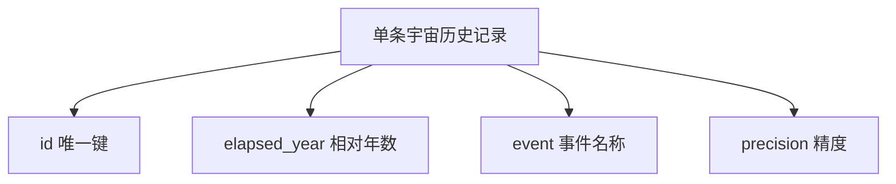
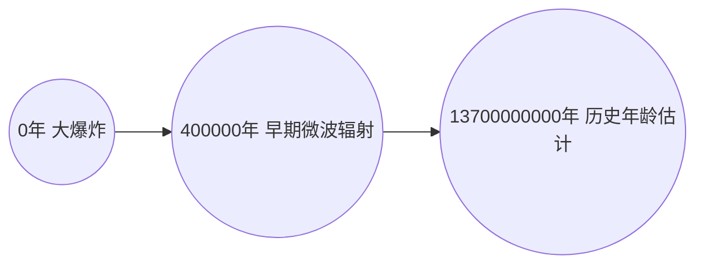
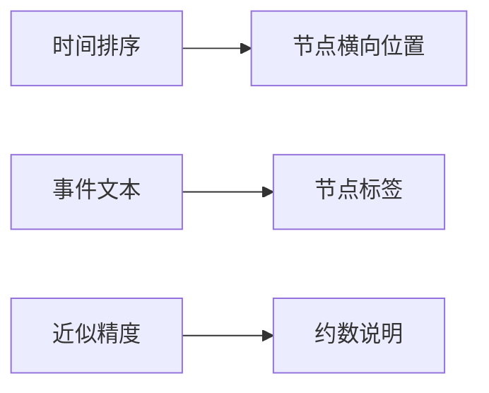
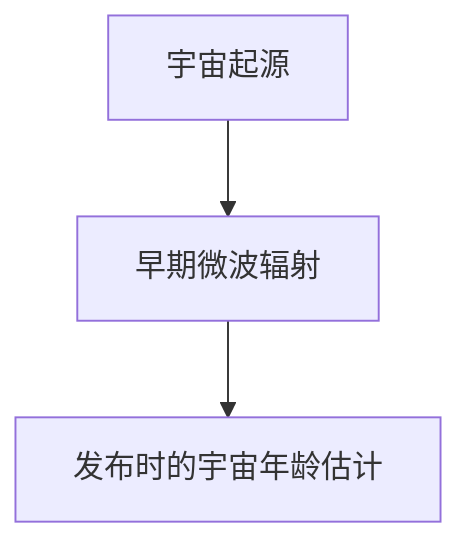
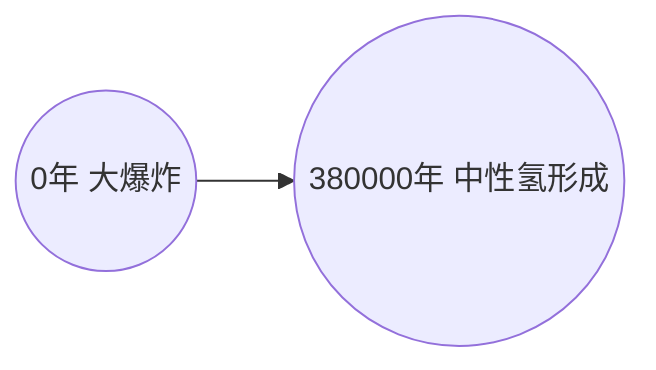
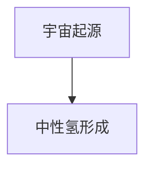

# 01｜编年型信息图形 · 概念定义
**基础类型：编年型（唯一五大基础类型之一）**｜版本：V1.0｜2026-11-19

## 定义
以具有确定先后约束的**主序列**组织信息，使读者能够追踪进程、阶段、步骤或状态变化。时间是常见的排序字段，但并非编年型的必要条件；不能将“时间轴外观”直接等同于“编年型数据逻辑”。

## A｜基本的数据逻辑
本项目根据此前三幅案例分析，把以下三项作为优先检查的**核心判据**：
1. **单向性**：以一条主导的前进方向组织信息，前后单元可以辨认；不是要求视觉必须从左到右。
2. **低维度**：以一个主要顺序维度统领阅读；单元可拥有多项属性，因此不等于原始表格只有一两列。
3. **不可逆性**：**在过程或演变意义上**随意调换关键阶段将破坏事实或步骤约束；不是说人不能倒序阅读、过程在现实中永不回退。只有“排序”而没有事实上的阶段依赖时，需明确标注为“有序展示”，不得强行认定因果与不可逆进程。

抽象关系：序列 S=(N₁,N₂,…,Nₙ)，每个节点具有稳定的 order_key，可有 predecessor_id。关键是 **N₁→N₂→N₃** 的顺序意义，而非节点内容必须是日期。

**判断边界**：首字母排序是字母表型；按销量大小排序如果主要传递优先级，则是层级型；只是同列罗列不同物品，则是编目型。循环反复过程可用闭环展示，不能自动套用“不可逆”。

## B｜统计图形／统计方法与计算
- **必要的不是统计量，而是排序或先后关系校验**：顺序索引、前驱条件、阶段划分。
- 当存在真实定量时间和数值时，才计算：阶段时长、节点间隔、相邻差值 Δx、累计量、平均变化率（需说明基数/单位）。
- 可借用**事件时间轴、阶段链、泳道序列、Gantt 区间条、序列点图、折线图、阶段柱状图**。折线只适合有相邻数值点、且连线含义明确的数据；等距排版不代表等时间间隔。
- **禁忌**：先后≠因果；箭头≠必然的单向演化；累计量不能与单阶段发生量混用。

## C｜视觉编码
| 通道 | 对应的信息含义 | 优化与边界 |
|---|---|---|
| 点 | 阶段/事件节点、转折 | 关键节点可强调，但不能改变节点顺序 |
| 线 | 主序列、连接、前驱 | 有向线明示推进；依赖关系要与装饰线区分 |
| 面 | 阶段区间、章节背景 | 定量长度须按比例；仅作分节的条带可以等宽 |
| 体 | 立体对象或示意场景 | 辅助内容理解，不能依体积装饰冒充数量 |
| 符号 | 节点身份、动作、结果 | 图标随主题变，单套符号保持语法统一 |
| 色彩 | 阶段分区、多轨道类别 | 同类同色；连续值另配有刻度的色标 |
| 字体／文字 | 节点标题、序号、注释 | 先读顺序，再读节点内容；保留关键信息 |

视觉优先级：**主轴与节点顺序 > 前后连接 > 阶段层次 > 图标配色与装饰**。

## D｜数据／信息架构
**一行一个节点，一列一个属性；最小要求是稳定 ID 与顺序键，不能用 Excel 行数/列数直接判断类型。**

| order_key | node_id | name | predecessor_id | description |
|---:|---|---|---|---|
| 1 | N01 | 阶段甲 | — | 输入或起点 |
| 2 | N02 | 阶段乙 | N01 | 处理或演变 |
| 3 | N03 | 阶段丙 | N02 | 结果或终点 |

此表是**抽象结构示例**，不是来自案例的真实数据。时间型按需增加 start_time、end_time；多线型增加 track_id；量化型增加 value、unit。信息结构为：节点集合→明确排序→阶段分组→局部属性→说明/出处。

## E｜视觉叙事架构
**起点（问题/前提）→ 发展单元 → 关键转折 → 当前/最终状态**。先提供可一眼辨认的顺序主轴，再对关键节点增加解释；多条并行路径必须共享可解释的参照。非关键节点可以抽象，但不可改变真实顺序。

---

# 案例验证与分析

以下案例内容从原有案例文档迁入本定义文档，保留原始图片链接、来源说明、数据摘录、清洗过程、字段结构、图形分析和叙事分析。案例证据用于检验和补充上面的类型定义；如案例仅为抽样或来源未完整转录，仍以原文限制说明为准。

# 编年型 · 案例A：宇宙历史

## 原始图片与来源

[原始作品与授权](https://commons.wikimedia.org/wiki/File:Timeline_of_the_Universe.jpg)；NASA/JPL-Caltech。数据来自作品发布页说明，非完整图内转录。

## 原始数据

| 时间描述 | 事件 |
|---|---|
| Big Bang | 大爆炸 |
| 约40万年 | 早期微波辐射 |
| 约137亿年 | 发布时估计的宇宙年龄 |

## 数据清洗

| 原始值 | 清洗值 | 规则 |
|---|---:|---|
| Big Bang | 0 | 定义相对起点 |
| 约40万年 | 400000 | 统一为年，保留近似性质 |
| 约137亿年 | 13700000000 | 亿转换为数值，保留历史估计口径 |

## 清洗后数据集与数据字典

| id | elapsed_year | event | precision |
|---|---:|---|---|
| E01 | 0 | 大爆炸 | 定义起点 |
| E02 | 400000 | 早期微波辐射 | 约数 |
| E03 | 13700000000 | 发布时的宇宙年龄 | 约数 |

id：文本唯一键；elapsed_year：相对大爆炸的年数，整数；event：文本标签；precision：精度类别。未获来源支持的阶段数值不补写。

## 数据结构与字段组合含义

时间＋事件构成历史顺序；时间＋精度区分定义起点和近似估计。按时间升序排序。

## 统计图形与视觉编码

### 基础图形：阶段时间轴

节点间距不是时间比例。原图属于历史示意，不能将事件数当成宇宙物理量。RAWGraphs 可用散点图表达定量时间位置，以 elapsed_year 为 X，固定 Y 为辅助常量，event 为标签；不需要求和或平均。

### 视觉编码图

## 叙事结构

## 设计总结

时间作为主索引，节点标注事件，连接线表达先后；区分顺序轴与等比例时间轴。当前为发布页可核实数据的子集，非完整原图复刻。

---

# 编年型 · 案例B：宇宙历史

## 原始图片与来源

[原始作品与授权](https://commons.wikimedia.org/wiki/File:History_of_the_Universe.svg)；Drbogdan；CC BY-SA 3.0。数据来自[原始PNG版本说明](https://commons.wikimedia.org/wiki/File:HistoryOfUniverse-BICEP2-20140317.png)，非完整图内转录。

## 原始数据

| 时间描述 | 事件 |
|---|---|
| Big Bang | 大爆炸 |
| 380 000 years | 中性氢形成 |

## 数据清洗

| 原始值 | 清洗值 | 规则 |
|---|---:|---|
| Big Bang | 0 | 定义相对起点 |
| 380 000 years | 380000 | 统一为年，保留近似性质 |

## 清洗后数据集与数据字典

| id | elapsed_year | event | precision |
|---|---:|---|---|
| E01 | 0 | 大爆炸 | 定义起点 |
| E02 | 380000 | 中性氢形成 | 约数 |

id：文本唯一键；elapsed_year：相对大爆炸的年数，整数；event：文本标签；precision：精度类别。未获来源支持的阶段数值不补写。

## 数据结构与字段组合含义

时间＋事件构成历史顺序；时间＋精度区分定义起点和近似估计。按时间升序排序。

## 统计图形与视觉编码

### 基础图形：阶段时间轴

节点间距不是时间比例。原图属于历史示意，不能将事件数当成宇宙物理量。RAWGraphs 可用散点图表达定量时间位置，以 elapsed_year 为 X，固定 Y 为辅助常量，event 为标签；不需要求和或平均。

### 视觉编码图

## 叙事结构

## 设计总结

时间作为主索引，节点标注事件，连接线表达先后；区分顺序轴与等比例时间轴。当前为发布页可核实数据的子集，非完整原图复刻。

