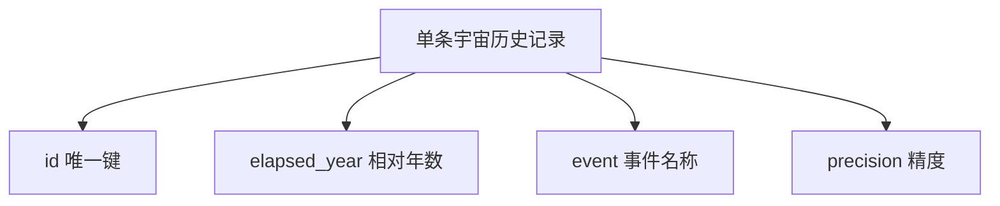
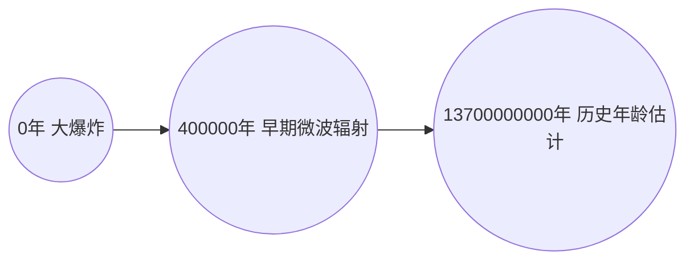
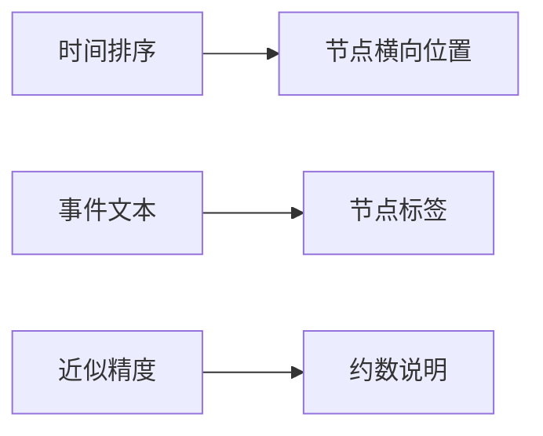
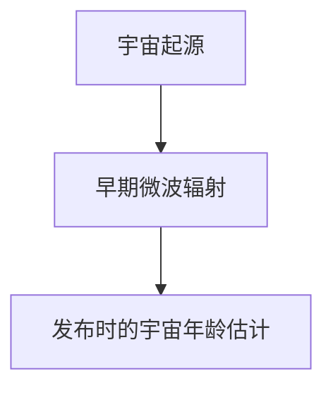
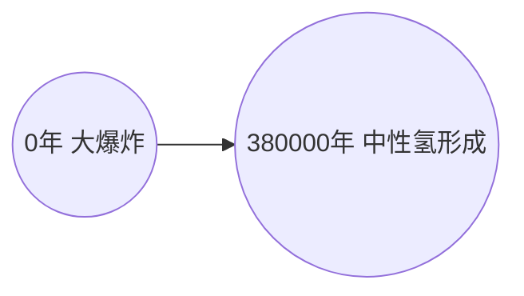
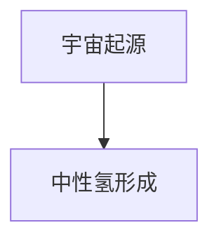

# 编年型｜类型定义与基础设计逻辑

> 本文档定义该类型的信息组织本质、图形统计逻辑、视觉编码、信息架构与叙事方式。具体案例是否符合该类型，需回到原图、来源和实际数据逐项验证；不能把类型定义当作案例事实。

## A. 基本的数据逻辑：数据结构的本质

以时间为主索引，将事件、状态或作品按发生先后组织；核心数据结构是带时间戳的事件序列，常含事件、时间、地点、人物、阶段及来源字段。

## B. 统计图形：统计方式与计算方式

时间序列折线/面积图用于连续数值变化；时间轴用于离散事件；阶段统计可用分组柱状图或累计面积图。可计算变化量、增长率、阶段总量、移动平均；事件本身不应强行数值化。

## C. 视觉编码：点、线、面、体、符号与色彩

点表示事件节点；线表示时间顺序或趋势；面表示阶段范围/累计量；体积仅在有第三维量值且图例明确时使用；符号区分事件类别；色彩区分时期或主题，明度可表示强度但需图例。

## D. 数据／信息架构

按时间升序排列，以事件为记录单位；时间字段可拆成年/月/日，配合类别、地点、主体、数值和来源；处理同一时刻多事件、时间精度不一致和不确定日期。

## E. 视觉叙事架构

从起点建立背景，沿时间推进，突出转折、峰值、断裂与结果；读者按时间顺序阅读，最后理解发展脉络及因果证据边界。

---

# 案例验证与分析

以下案例内容从原有案例文档迁入本定义文档，保留原始图片链接、来源说明、数据摘录、清洗过程、字段结构、图形分析和叙事分析。案例证据用于检验和补充上面的类型定义；如案例仅为抽样或来源未完整转录，仍以原文限制说明为准。

# 编年型 · 案例A：宇宙历史

## 原始图片与来源

[原始作品与授权](https://commons.wikimedia.org/wiki/File:Timeline_of_the_Universe.jpg)；NASA/JPL-Caltech。数据来自作品发布页说明，非完整图内转录。

## 原始数据

| 时间描述 | 事件 |
|---|---|
| Big Bang | 大爆炸 |
| 约40万年 | 早期微波辐射 |
| 约137亿年 | 发布时估计的宇宙年龄 |

## 数据清洗

| 原始值 | 清洗值 | 规则 |
|---|---:|---|
| Big Bang | 0 | 定义相对起点 |
| 约40万年 | 400000 | 统一为年，保留近似性质 |
| 约137亿年 | 13700000000 | 亿转换为数值，保留历史估计口径 |

## 清洗后数据集与数据字典

| id | elapsed_year | event | precision |
|---|---:|---|---|
| E01 | 0 | 大爆炸 | 定义起点 |
| E02 | 400000 | 早期微波辐射 | 约数 |
| E03 | 13700000000 | 发布时的宇宙年龄 | 约数 |

id：文本唯一键；elapsed_year：相对大爆炸的年数，整数；event：文本标签；precision：精度类别。未获来源支持的阶段数值不补写。

## 数据结构与字段组合含义

时间＋事件构成历史顺序；时间＋精度区分定义起点和近似估计。按时间升序排序。

## 统计图形与视觉编码

### 基础图形：阶段时间轴

节点间距不是时间比例。原图属于历史示意，不能将事件数当成宇宙物理量。RAWGraphs 可用散点图表达定量时间位置，以 elapsed_year 为 X，固定 Y 为辅助常量，event 为标签；不需要求和或平均。

### 视觉编码图

## 叙事结构

## 设计总结

时间作为主索引，节点标注事件，连接线表达先后；区分顺序轴与等比例时间轴。当前为发布页可核实数据的子集，非完整原图复刻。

---

# 编年型 · 案例B：宇宙历史

## 原始图片与来源

[原始作品与授权](https://commons.wikimedia.org/wiki/File:History_of_the_Universe.svg)；Drbogdan；CC BY-SA 3.0。数据来自[原始PNG版本说明](https://commons.wikimedia.org/wiki/File:HistoryOfUniverse-BICEP2-20140317.png)，非完整图内转录。

## 原始数据

| 时间描述 | 事件 |
|---|---|
| Big Bang | 大爆炸 |
| 380 000 years | 中性氢形成 |

## 数据清洗

| 原始值 | 清洗值 | 规则 |
|---|---:|---|
| Big Bang | 0 | 定义相对起点 |
| 380 000 years | 380000 | 统一为年，保留近似性质 |

## 清洗后数据集与数据字典

| id | elapsed_year | event | precision |
|---|---:|---|---|
| E01 | 0 | 大爆炸 | 定义起点 |
| E02 | 380000 | 中性氢形成 | 约数 |

id：文本唯一键；elapsed_year：相对大爆炸的年数，整数；event：文本标签；precision：精度类别。未获来源支持的阶段数值不补写。

## 数据结构与字段组合含义

时间＋事件构成历史顺序；时间＋精度区分定义起点和近似估计。按时间升序排序。

## 统计图形与视觉编码

### 基础图形：阶段时间轴

节点间距不是时间比例。原图属于历史示意，不能将事件数当成宇宙物理量。RAWGraphs 可用散点图表达定量时间位置，以 elapsed_year 为 X，固定 Y 为辅助常量，event 为标签；不需要求和或平均。

### 视觉编码图

## 叙事结构

## 设计总结

时间作为主索引，节点标注事件，连接线表达先后；区分顺序轴与等比例时间轴。当前为发布页可核实数据的子集，非完整原图复刻。

