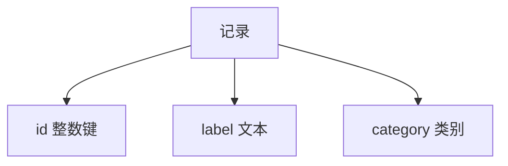
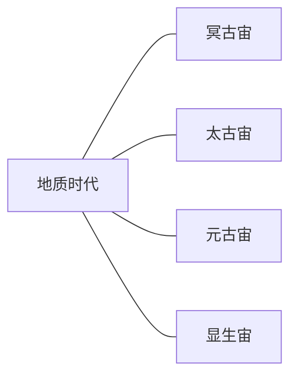
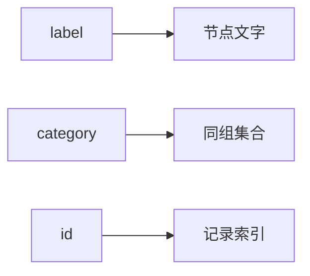
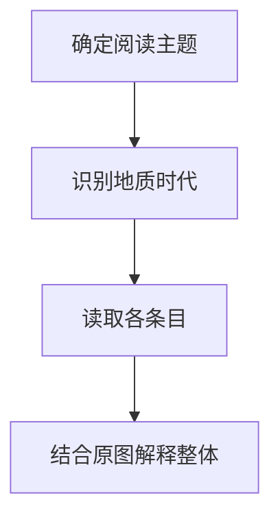
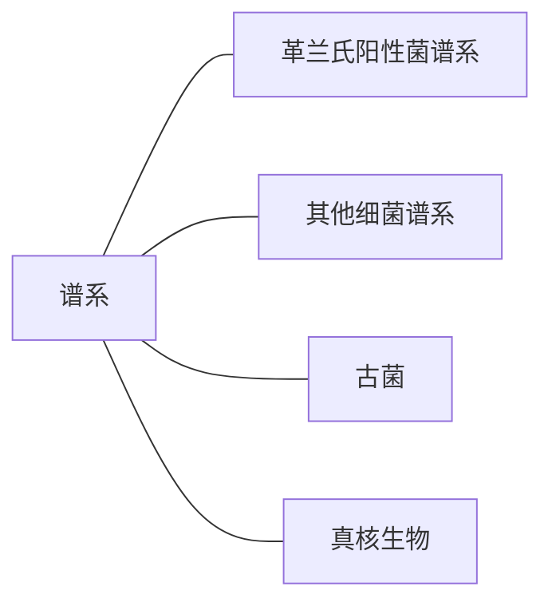
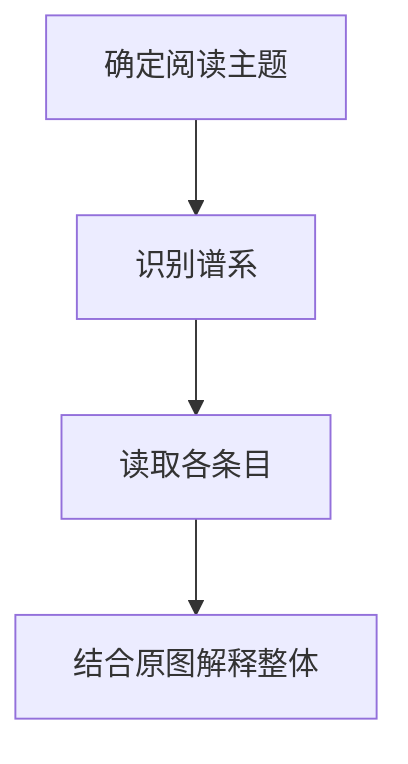

# 层级型｜类型定义与基础设计逻辑

> 本文档定义该类型的信息组织本质、图形统计逻辑、视觉编码、信息架构与叙事方式。具体案例是否符合该类型，需回到原图、来源和实际数据逐项验证；不能把类型定义当作案例事实。

## A. 基本的数据逻辑：数据结构的本质

以父子、包含、从属关系为核心；数据本质是树或森林结构，每个非根节点有父节点，节点可有名称、层级、父节点ID及子节点。

## B. 统计图形：统计方式与计算方式

树状图、缩进树、树形图、旭日图、矩形树图；若节点有数量，可用面积映射权重，计算各层级节点数、子节点占比及父级汇总。

## C. 视觉编码：点、线、面、体、符号与色彩

点/节点表示实体；连线表示父子关系；面/矩形表示节点及其权重；圆环层级表示深度；符号区分节点类型；色彩区分分支或层级，面积需对应可加总数值。

## D. 数据／信息架构

以 parent_id 建立邻接表或嵌套JSON；包含 node_id、parent_id、label、level、value、category；检查孤立节点、多父节点、循环引用及层级缺失。

## E. 视觉叙事架构

通常从根节点/整体进入，逐层向下展开，读者在整体与局部间切换，理解分类、隶属和规模分布。

---

# 案例验证与分析

以下案例内容从原有案例文档迁入本定义文档，保留原始图片链接、来源说明、数据摘录、清洗过程、字段结构、图形分析和叙事分析。案例证据用于检验和补充上面的类型定义；如案例仅为抽样或来源未完整转录，仍以原文限制说明为准。

# 02-层级型：地质年代生命树

## 原图与来源

[作品发布页面](https://commons.wikimedia.org/wiki/File:Tree_of_life_on_Earth_with_geological_timeline.jpg)；作者：Pablo Carlos Budassi；授权：CC BY-SA 4.0。图像外链引用，未修改原图。

## 定义与选取依据
以父子与包含关系组织信息。本篇从该类型视角研究作品，部分案例为相邻类型参考而非严格典型。尤其字母表型需要另核对实际排序；手稿型研究拼贴中的历史手写材料，而非整个拼贴都属于手稿。

## 原始数据与清洗
依据作品发布说明抽取以下项目，非完整图内转录。

| 原始描述 | 规范标签 | 清洗规则 |
|---|---|---|
| 冥古宙 | 冥古宙 | 保留原义及近似标记，不补造数值 |
| 太古宙 | 太古宙 | 保留原义及近似标记，不补造数值 |
| 元古宙 | 元古宙 | 保留原义及近似标记，不补造数值 |
| 显生宙 | 显生宙 | 保留原义及近似标记，不补造数值 |

## 清洗后数据集
| id | label | category |
|---|---|---|
| 1 | 冥古宙 | 地质时代 |
| 2 | 太古宙 | 地质时代 |
| 3 | 元古宙 | 地质时代 |
| 4 | 显生宙 | 地质时代 |

数据字典：id 为本地整数键；label 为来源描述的中文规范标签；category 为研究者标注的字段类别。缺失的原始量值不填零。

## 数据结构图

## 字段组合与统计方式
label 与 category 组成可分类检索的信息单元；id 与 label 提供唯一索引。本次抽取 4 条，不能代表原图全部数据。仅可统计抽样条目数，不可把类别计数误作实际对象数量或份额。

## 基础图形

上图用于展示来源说明中的条目集合，不声称各节点之间有直接因果或真实父子关系。无可验证的连续量值时，用定性图而非虚构统计柱图。

## 视觉编码图

## 叙事结构

## 设计总结与限制
以父子与包含关系组织信息。本图为发布说明支持的抽样分析，不是全量复刻。原图图例、完整数值及实际视觉编码需进一步逐项核对。Mermaid 图为自主分析图。

---

# 02-层级型：生命谱系时间图

## 原图与来源

[作品发布页面](https://commons.wikimedia.org/wiki/File:Timeline_of_life.png)；作者：Crion；授权：CC BY-SA 3.0。图像外链引用，未修改原图。

## 定义与选取依据
以父子与包含关系组织信息。本篇从该类型视角研究作品，部分案例为相邻类型参考而非严格典型。尤其字母表型需要另核对实际排序；手稿型研究拼贴中的历史手写材料，而非整个拼贴都属于手稿。

## 原始数据与清洗
依据作品发布说明抽取以下项目，非完整图内转录。

| 原始描述 | 规范标签 | 清洗规则 |
|---|---|---|
| 革兰氏阳性菌谱系 | 革兰氏阳性菌谱系 | 保留原义及近似标记，不补造数值 |
| 其他细菌谱系 | 其他细菌谱系 | 保留原义及近似标记，不补造数值 |
| 古菌 | 古菌 | 保留原义及近似标记，不补造数值 |
| 真核生物 | 真核生物 | 保留原义及近似标记，不补造数值 |

## 清洗后数据集
| id | label | category |
|---|---|---|
| 1 | 革兰氏阳性菌谱系 | 谱系 |
| 2 | 其他细菌谱系 | 谱系 |
| 3 | 古菌 | 谱系 |
| 4 | 真核生物 | 谱系 |

数据字典：id 为本地整数键；label 为来源描述的中文规范标签；category 为研究者标注的字段类别。缺失的原始量值不填零。

## 数据结构图

## 字段组合与统计方式
label 与 category 组成可分类检索的信息单元；id 与 label 提供唯一索引。本次抽取 4 条，不能代表原图全部数据。仅可统计抽样条目数，不可把类别计数误作实际对象数量或份额。

## 基础图形

上图用于展示来源说明中的条目集合，不声称各节点之间有直接因果或真实父子关系。无可验证的连续量值时，用定性图而非虚构统计柱图。

## 视觉编码图

## 叙事结构

## 设计总结与限制
以父子与包含关系组织信息。本图为发布说明支持的抽样分析，不是全量复刻。原图图例、完整数值及实际视觉编码需进一步逐项核对。Mermaid 图为自主分析图。

