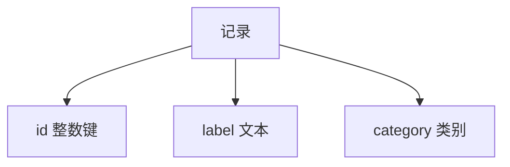
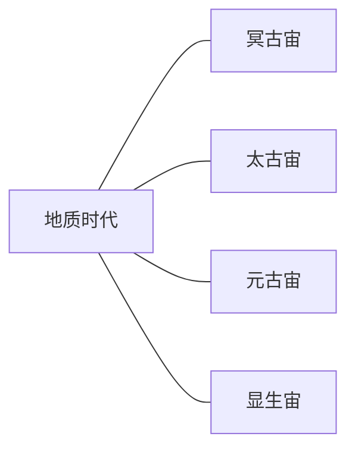
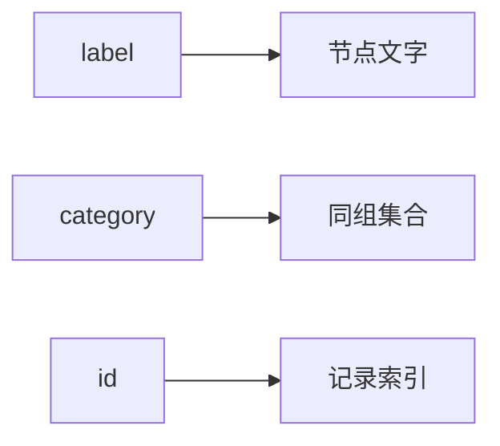
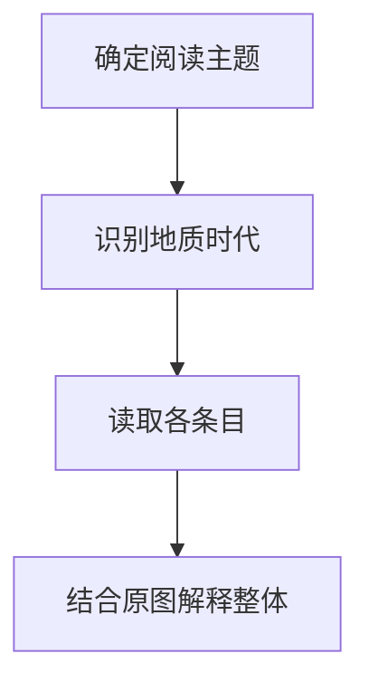
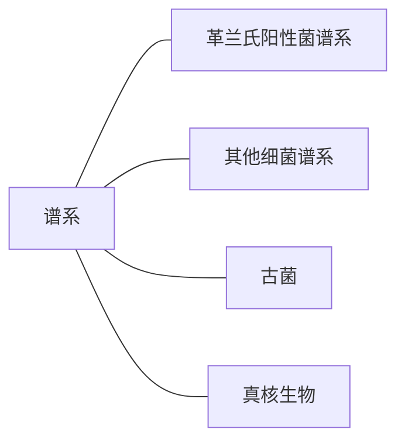
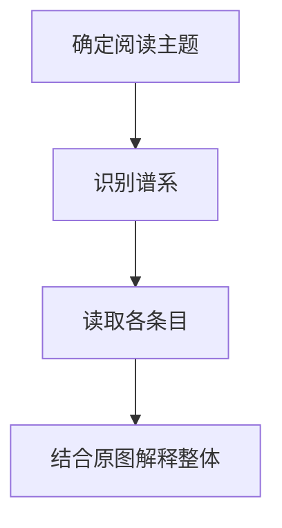

# 02｜层级型信息图形 · 概念定义
**基础类型：层级型（唯一五大基础类型之一）**｜版本：V1.0｜2026-11-19

## 定义
以**上下位、主次、包含、从属或等级差异**为核心关系组织信息，让读者看出“谁处于上层、谁属于谁、谁的权重更大”。视觉上有大小差异不等于数据上有层级。

## A｜基本的数据逻辑
两种层级关系必须区分：
- **结构层级**：父节点 parent→子节点 child，形成树或嵌套组织。适合组织架构、知识分解、概念包含。
- **等级层级**：共同指标上的序位/等级关系（rank 或 level），未必存在父子关系。适合优先级、规模排序和能力等级。
主导特征是**上下位可判定性**；不能把“按一个属性分类”的编目型直接当层级型，也不能把前后步骤当高低等级。复杂交叉关系可局部表现，但必须解释主归属所依据的层级属性。

## B｜统计图形／计算方式
- 结构型：深度、层数、子节点数、祖先/后代关系、叶节点、分支数量。
- 量化型：节点权重、同级份额、父级汇总（仅当子级互斥、穷尽且可加时才成立）。
- 可借用组织结构图、树图、放射树、矩形树图 Treemap、旭日图 Sunburst、冰柱图 Icicle；仅等级比较可用条形排名图或点图。
- 区分：聚类树状图只有在有距离指标及聚类规则时才用于表达计算出的聚类层级；不可用任意树线冒充统计推断。

## C｜视觉编码
| 通道 | 用途 | 方法 |
|---|---|---|
| 点 | 节点、角色、条目 | 按层级定位；不同节点不应被误认同级 |
| 线 | 上下位与归属连线 | 减少交叉；父子连线应与普通指示线区分 |
| 面 | 嵌套、子树分区、权重 | 数量对应面积时按面积比例，不凭视觉喜好缩放 |
| 体 | 立体层叠展示 | 仅作辅助；透视与遮挡损害定量可比性 |
| 符号 | 分支语义、职责 | 分支符号统一，符号本身不任意代表级别 |
| 色彩 | 分支或层深 | 类别色用于分支，明度序列用于等级，避免混淆 |
| 文字 | 层级标题、级次、权重 | 字号/字重/缩进与真实层级一致 |

编码优先级：**上位关系与层深 > 分支权重 > 语义图标与修饰**。

## D｜数据／信息架构
树型最小表：**一行一个节点，parent_id 存放父节点 ID**。
| node_id | parent_id | label | depth | value |
|---|---|---|---:|---:|
| A | — | 总体 | 0 | — |
| A1 | A | 部分甲 | 1 | 12 |
| A2 | A | 部分乙 | 1 | 8 |

这是结构示意值，非真实案例。等级型应采用 item_id、metric、rank_basis、rank，而不伪造父节点。检查循环引用、孤立节点、父子重复计数、是否可加。信息路径：总类→一级结构→各分支→叶节点→属性或指标。

## E｜视觉叙事架构
结构型：**整体定位→展开分支→识别关键节点→返回整体关系**。等级型：**说明判定标准→呈现高低梯度→比较关键差异→说明结论**。有排序不等于有因果，主次位置也不意味着发生先后。

---

# 案例验证与分析

以下案例内容从原有案例文档迁入本定义文档，保留原始图片链接、来源说明、数据摘录、清洗过程、字段结构、图形分析和叙事分析。案例证据用于检验和补充上面的类型定义；如案例仅为抽样或来源未完整转录，仍以原文限制说明为准。

# 02-层级型：地质年代生命树

## 原图与来源

[作品发布页面](https://commons.wikimedia.org/wiki/File:Tree_of_life_on_Earth_with_geological_timeline.jpg)；作者：Pablo Carlos Budassi；授权：CC BY-SA 4.0。图像外链引用，未修改原图。

## 定义与选取依据
以父子与包含关系组织信息。本篇从该类型视角研究作品，部分案例为相邻类型参考而非严格典型。尤其字母表型需要另核对实际排序；手稿型研究拼贴中的历史手写材料，而非整个拼贴都属于手稿。

## 原始数据与清洗
依据作品发布说明抽取以下项目，非完整图内转录。

| 原始描述 | 规范标签 | 清洗规则 |
|---|---|---|
| 冥古宙 | 冥古宙 | 保留原义及近似标记，不补造数值 |
| 太古宙 | 太古宙 | 保留原义及近似标记，不补造数值 |
| 元古宙 | 元古宙 | 保留原义及近似标记，不补造数值 |
| 显生宙 | 显生宙 | 保留原义及近似标记，不补造数值 |

## 清洗后数据集
| id | label | category |
|---|---|---|
| 1 | 冥古宙 | 地质时代 |
| 2 | 太古宙 | 地质时代 |
| 3 | 元古宙 | 地质时代 |
| 4 | 显生宙 | 地质时代 |

数据字典：id 为本地整数键；label 为来源描述的中文规范标签；category 为研究者标注的字段类别。缺失的原始量值不填零。

## 数据结构图

## 字段组合与统计方式
label 与 category 组成可分类检索的信息单元；id 与 label 提供唯一索引。本次抽取 4 条，不能代表原图全部数据。仅可统计抽样条目数，不可把类别计数误作实际对象数量或份额。

## 基础图形

上图用于展示来源说明中的条目集合，不声称各节点之间有直接因果或真实父子关系。无可验证的连续量值时，用定性图而非虚构统计柱图。

## 视觉编码图

## 叙事结构

## 设计总结与限制
以父子与包含关系组织信息。本图为发布说明支持的抽样分析，不是全量复刻。原图图例、完整数值及实际视觉编码需进一步逐项核对。Mermaid 图为自主分析图。

---

# 02-层级型：生命谱系时间图

## 原图与来源

[作品发布页面](https://commons.wikimedia.org/wiki/File:Timeline_of_life.png)；作者：Crion；授权：CC BY-SA 3.0。图像外链引用，未修改原图。

## 定义与选取依据
以父子与包含关系组织信息。本篇从该类型视角研究作品，部分案例为相邻类型参考而非严格典型。尤其字母表型需要另核对实际排序；手稿型研究拼贴中的历史手写材料，而非整个拼贴都属于手稿。

## 原始数据与清洗
依据作品发布说明抽取以下项目，非完整图内转录。

| 原始描述 | 规范标签 | 清洗规则 |
|---|---|---|
| 革兰氏阳性菌谱系 | 革兰氏阳性菌谱系 | 保留原义及近似标记，不补造数值 |
| 其他细菌谱系 | 其他细菌谱系 | 保留原义及近似标记，不补造数值 |
| 古菌 | 古菌 | 保留原义及近似标记，不补造数值 |
| 真核生物 | 真核生物 | 保留原义及近似标记，不补造数值 |

## 清洗后数据集
| id | label | category |
|---|---|---|
| 1 | 革兰氏阳性菌谱系 | 谱系 |
| 2 | 其他细菌谱系 | 谱系 |
| 3 | 古菌 | 谱系 |
| 4 | 真核生物 | 谱系 |

数据字典：id 为本地整数键；label 为来源描述的中文规范标签；category 为研究者标注的字段类别。缺失的原始量值不填零。

## 数据结构图

## 字段组合与统计方式
label 与 category 组成可分类检索的信息单元；id 与 label 提供唯一索引。本次抽取 4 条，不能代表原图全部数据。仅可统计抽样条目数，不可把类别计数误作实际对象数量或份额。

## 基础图形

上图用于展示来源说明中的条目集合，不声称各节点之间有直接因果或真实父子关系。无可验证的连续量值时，用定性图而非虚构统计柱图。

## 视觉编码图

## 叙事结构

## 设计总结与限制
以父子与包含关系组织信息。本图为发布说明支持的抽样分析，不是全量复刻。原图图例、完整数值及实际视觉编码需进一步逐项核对。Mermaid 图为自主分析图。

