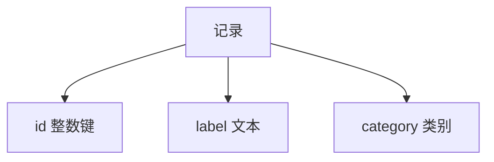
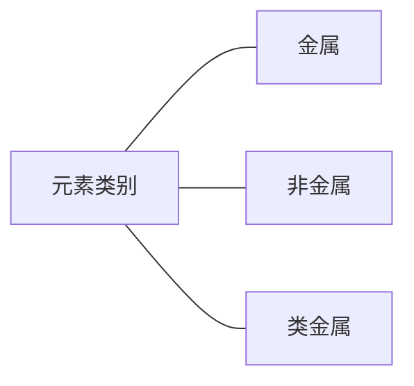
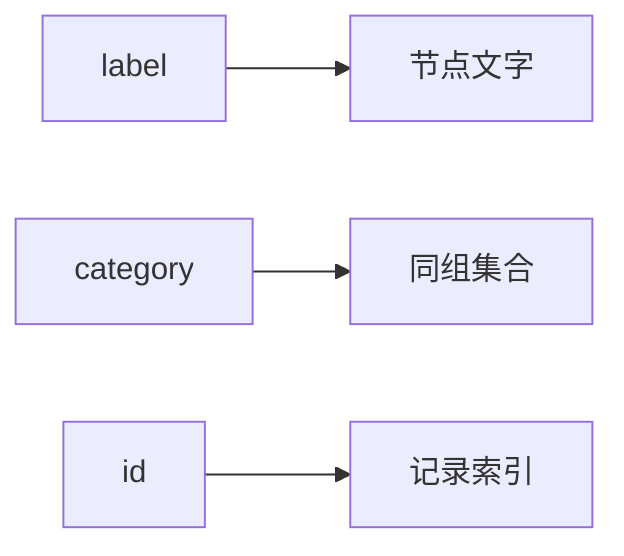
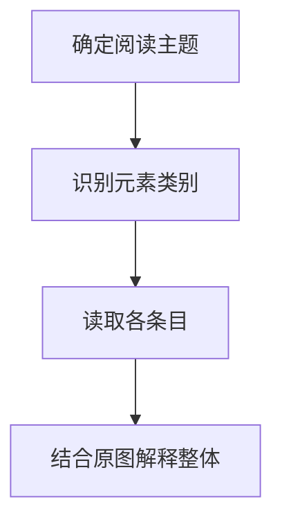
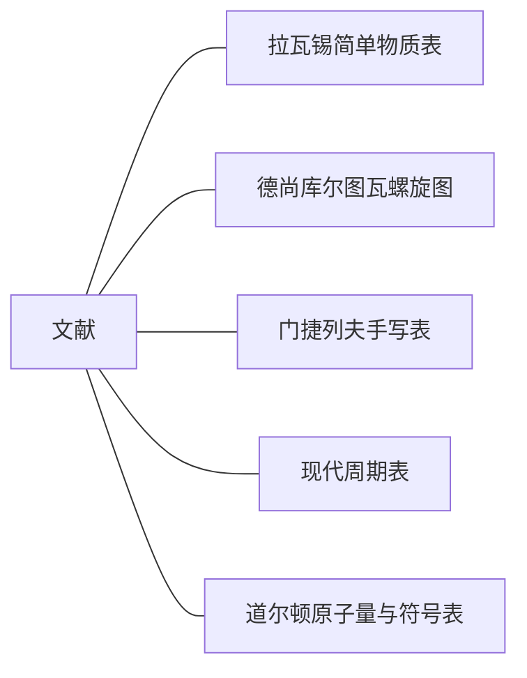
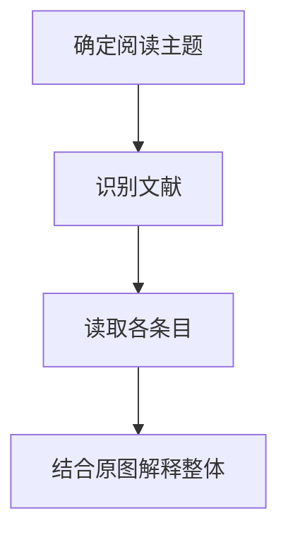

# 03｜编目型信息图形 · 概念定义
**基础类型：编目型（唯一五大基础类型之一）**｜版本：V1.0｜2026-11-19

## 定义
以**类别、主题或属性归属**为基本秩序，把对象分组并比较，回答“有哪些类、各类包含什么、不同类别有什么异同”。核心不是“用列表排版”，而是可以复核的**分类规则和成员关系**。

## A｜基本的数据逻辑
抽象模型：对象集合 O、类别集合 C、归属关系 O→C。对于多标签资料，O 与 C 是多对多关系。
- **横向并列**是典型特征；类别之间没有必然的发生次序或上位从属。
- 互斥分类：一项归一个类别，类目可彼此比较；多标签分类：一项可归多类，统计总和可超过对象数。
- 分类依据必须明确（功能/材料/主题等），否则只是版式分块。
- 若类别之间形成父子级联，则包含层级逻辑；若作品主要让读者看到父子关系，基础主归属应改判层级型。

## B｜统计图形／计算方式
- 频数 n(c)、构成比例 n(c)/N、组内均值/中位数、组间差值、交叉分布；按数据定义决定能否合计。
- 可借用分类条形图、点阵符号图、分组柱形图、交叉矩阵、小倍数图、百分比堆积条、适合比例结构的环/饼图。
- 只有在**互斥且穷尽**的类别上，总占比才可被解释为 100%；多标签“占比”必须明确是按成员数还是响应次数计算。
- 纯名录可以**完全不做数值统计**，不得编造各类的比例。

## C｜视觉编码
| 通道 | 作用 | 方法 |
|---|---|---|
| 点 | 类别成员/数量单元 | 点大小一致时用于计数；不能随意扩大个别对象 |
| 线 | 分组边界、比较、对应 | 分隔不同于因果与进程箭头 |
| 面 | 类别卡片、分区、矩阵单元 | 面积只有在映射数量时才允许直接比较 |
| 体 | 产品、工具、主题物的示意 | 负责识别，不承担未校准的数量编码 |
| 符号 | 类别识别、物品语义 | 可用系列图标，统一笔画与视觉比例 |
| 色彩 | 类别身份 | 一类一色或类目配色一致，避免伪造成连续量 |
| 文字 | 类名、规则、例项、说明 | 类名优先，解释归类依据，保持同级字体一致 |

编码优先级：**分类边界与类别名 > 类内成员 > 类别间差别 > 视觉美化**。

## D｜数据／信息架构
| item_id | item_name | category_id | attribute |
|---|---|---|---|
| I01 | 对象甲 | C1 | 属性甲 |
| I02 | 对象乙 | C1 | 属性乙 |
| I03 | 对象丙 | C2 | 属性丙 |

**一行一个对象**；若多标签，另设 **item_id + category_id** 关联表，每行一个归属关系。以上为结构示意而非案例。分类标准、类目代码、同义词、未归类项要记录。信息组织：分类准则→类别总览→各类成员→横向比较→归纳。

## E｜视觉叙事架构
**提出主题→说明分类依据→展示全体类别→聚焦典型类别→跨类比较**。通常支持跳读，类别次序可按用户需求自定；排序本身不制造编年型进程意义。

---

# 案例验证与分析

以下案例内容从原有案例文档迁入本定义文档，保留原始图片链接、来源说明、数据摘录、清洗过程、字段结构、图形分析和叙事分析。案例证据用于检验和补充上面的类型定义；如案例仅为抽样或来源未完整转录，仍以原文限制说明为准。

# 03-编目型：元素周期表

## 原图与来源

[作品发布页面](https://commons.wikimedia.org/wiki/File:Periodic_Table_Of_Elements.svg)；作者：Dmarcus100；授权：CC BY-SA 4.0。图像外链引用，未修改原图。

## 定义与选取依据
以类别和条目组织可检索集合。本篇从该类型视角研究作品，部分案例为相邻类型参考而非严格典型。尤其字母表型需要另核对实际排序；手稿型研究拼贴中的历史手写材料，而非整个拼贴都属于手稿。

## 原始数据与清洗
依据作品发布说明抽取以下项目，非完整图内转录。

| 原始描述 | 规范标签 | 清洗规则 |
|---|---|---|
| 金属 | 金属 | 保留原义及近似标记，不补造数值 |
| 非金属 | 非金属 | 保留原义及近似标记，不补造数值 |
| 类金属 | 类金属 | 保留原义及近似标记，不补造数值 |

## 清洗后数据集
| id | label | category |
|---|---|---|
| 1 | 金属 | 元素类别 |
| 2 | 非金属 | 元素类别 |
| 3 | 类金属 | 元素类别 |

数据字典：id 为本地整数键；label 为来源描述的中文规范标签；category 为研究者标注的字段类别。缺失的原始量值不填零。

## 数据结构图

## 字段组合与统计方式
label 与 category 组成可分类检索的信息单元；id 与 label 提供唯一索引。本次抽取 3 条，不能代表原图全部数据。仅可统计抽样条目数，不可把类别计数误作实际对象数量或份额。

## 基础图形

上图用于展示来源说明中的条目集合，不声称各节点之间有直接因果或真实父子关系。无可验证的连续量值时，用定性图而非虚构统计柱图。

## 视觉编码图

## 叙事结构

## 设计总结与限制
以类别和条目组织可检索集合。本图为发布说明支持的抽样分析，不是全量复刻。原图图例、完整数值及实际视觉编码需进一步逐项核对。Mermaid 图为自主分析图。

---

# 03-编目型：周期表历史文献拼贴

## 原图与来源

[作品发布页面](https://commons.wikimedia.org/wiki/File:Periodic_table_compilation.svg)；作者：见原页；授权：见原页。图像外链引用，未修改原图。

## 定义与选取依据
以类别和条目组织可检索集合。本篇从该类型视角研究作品，部分案例为相邻类型参考而非严格典型。尤其字母表型需要另核对实际排序；手稿型研究拼贴中的历史手写材料，而非整个拼贴都属于手稿。

## 原始数据与清洗
依据作品发布说明抽取以下项目，非完整图内转录。

| 原始描述 | 规范标签 | 清洗规则 |
|---|---|---|
| 拉瓦锡简单物质表 | 拉瓦锡简单物质表 | 保留原义及近似标记，不补造数值 |
| 德尚库尔图瓦螺旋图 | 德尚库尔图瓦螺旋图 | 保留原义及近似标记，不补造数值 |
| 门捷列夫手写表 | 门捷列夫手写表 | 保留原义及近似标记，不补造数值 |
| 现代周期表 | 现代周期表 | 保留原义及近似标记，不补造数值 |
| 道尔顿原子量与符号表 | 道尔顿原子量与符号表 | 保留原义及近似标记，不补造数值 |

## 清洗后数据集
| id | label | category |
|---|---|---|
| 1 | 拉瓦锡简单物质表 | 文献 |
| 2 | 德尚库尔图瓦螺旋图 | 文献 |
| 3 | 门捷列夫手写表 | 文献 |
| 4 | 现代周期表 | 文献 |
| 5 | 道尔顿原子量与符号表 | 文献 |

数据字典：id 为本地整数键；label 为来源描述的中文规范标签；category 为研究者标注的字段类别。缺失的原始量值不填零。

## 数据结构图

## 字段组合与统计方式
label 与 category 组成可分类检索的信息单元；id 与 label 提供唯一索引。本次抽取 5 条，不能代表原图全部数据。仅可统计抽样条目数，不可把类别计数误作实际对象数量或份额。

## 基础图形

上图用于展示来源说明中的条目集合，不声称各节点之间有直接因果或真实父子关系。无可验证的连续量值时，用定性图而非虚构统计柱图。

## 视觉编码图

## 叙事结构

## 设计总结与限制
以类别和条目组织可检索集合。本图为发布说明支持的抽样分析，不是全量复刻。原图图例、完整数值及实际视觉编码需进一步逐项核对。Mermaid 图为自主分析图。

