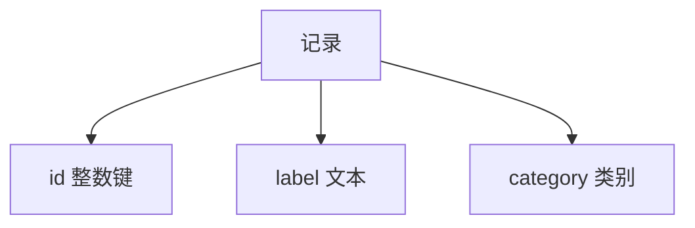
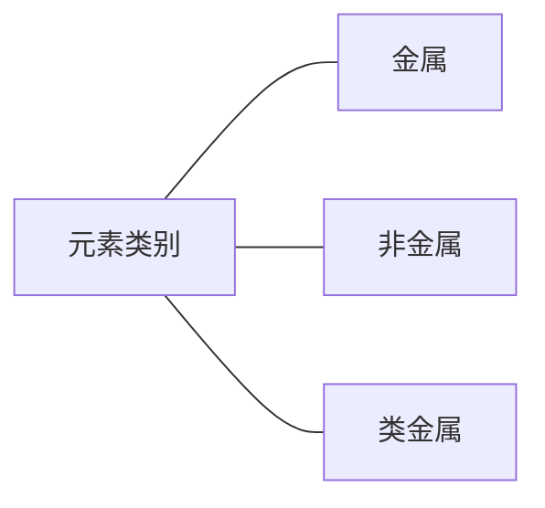
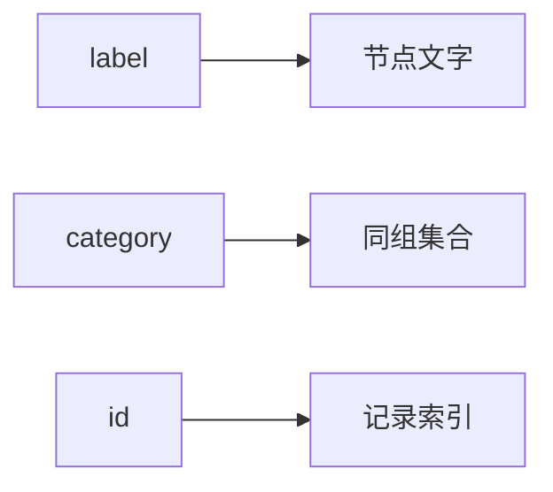
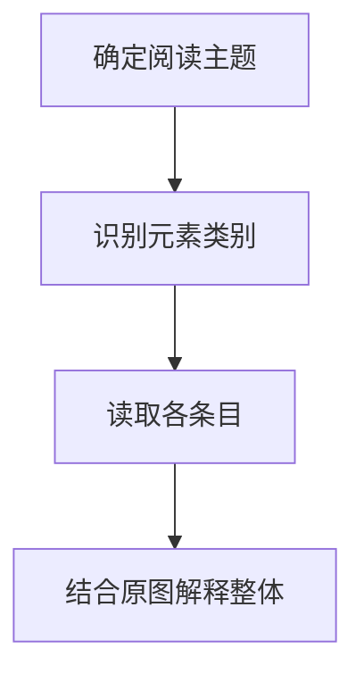
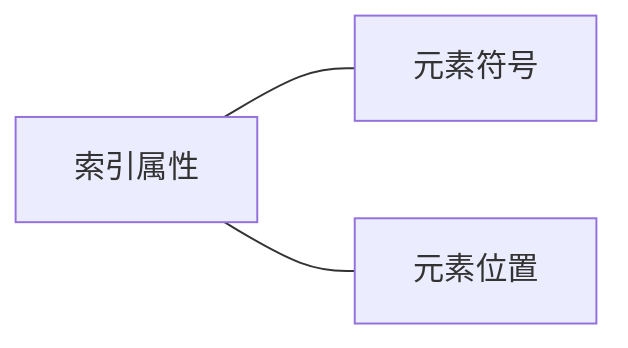
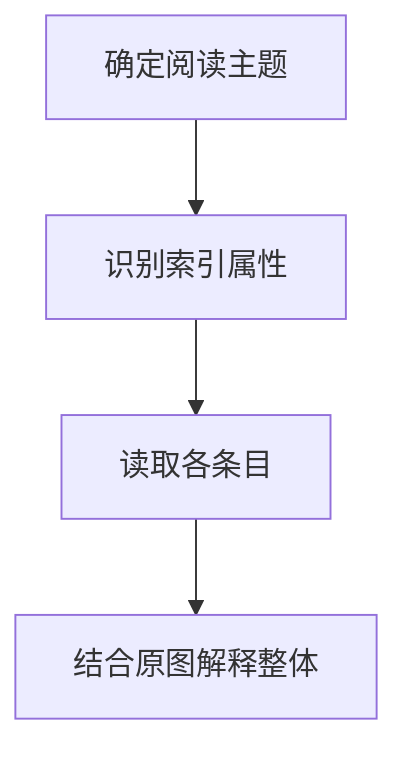

# 字母表型｜类型定义与基础设计逻辑

> 本文档定义该类型的信息组织本质、图形统计逻辑、视觉编码、信息架构与叙事方式。具体案例是否符合该类型，需回到原图、来源和实际数据逐项验证；不能把类型定义当作案例事实。

## A. 基本的数据逻辑：数据结构的本质

以字母、拼音首字母或字符索引作为主要检索入口；核心是字符键到词条记录的映射，而非单纯把文字排成列表。

## B. 统计图形：统计方式与计算方式

字母索引表、索引树、分组列表、字母频数条形图；可计算首字母词条数、字母分布、词频，但需区分索引排序与统计排序。

## C. 视觉编码：点、线、面、体、符号与色彩

字母/字符作为视觉锚点；点或图标标识词条；线分隔字母组；面作为字母分区；色彩突出当前索引或类别，不以颜色代替字母顺序。

## D. 数据／信息架构

字段包括原词条、规范词形、索引字符、语言/字母系统、释义、类别和来源；明确排序规则、大小写、变音符号、多语言转写及同音异形处理。

## E. 视觉叙事架构

先展示完整字母索引，再从选定字符进入词条组，最后通过释义或分类建立词汇关系；叙事重点是查找效率而非时间发展。

---

# 案例验证与分析

以下案例内容从原有案例文档迁入本定义文档，保留原始图片链接、来源说明、数据摘录、清洗过程、字段结构、图形分析和叙事分析。案例证据用于检验和补充上面的类型定义；如案例仅为抽样或来源未完整转录，仍以原文限制说明为准。

# 04-字母表型：元素周期表

## 原图与来源

[作品发布页面](https://commons.wikimedia.org/wiki/File:Periodic_Table_Of_Elements.svg)；作者：Dmarcus100；授权：CC BY-SA 4.0。图像外链引用，未修改原图。

## 定义与选取依据
以字母或符号作为索引；严格字母排序须另行核对。本篇从该类型视角研究作品，部分案例为相邻类型参考而非严格典型。尤其字母表型需要另核对实际排序；手稿型研究拼贴中的历史手写材料，而非整个拼贴都属于手稿。

## 原始数据与清洗
依据作品发布说明抽取以下项目，非完整图内转录。

| 原始描述 | 规范标签 | 清洗规则 |
|---|---|---|
| 金属 | 金属 | 保留原义及近似标记，不补造数值 |
| 非金属 | 非金属 | 保留原义及近似标记，不补造数值 |
| 类金属 | 类金属 | 保留原义及近似标记，不补造数值 |

## 清洗后数据集
| id | label | category |
|---|---|---|
| 1 | 金属 | 元素类别 |
| 2 | 非金属 | 元素类别 |
| 3 | 类金属 | 元素类别 |

数据字典：id 为本地整数键；label 为来源描述的中文规范标签；category 为研究者标注的字段类别。缺失的原始量值不填零。

## 数据结构图

## 字段组合与统计方式
label 与 category 组成可分类检索的信息单元；id 与 label 提供唯一索引。本次抽取 3 条，不能代表原图全部数据。仅可统计抽样条目数，不可把类别计数误作实际对象数量或份额。

## 基础图形

上图用于展示来源说明中的条目集合，不声称各节点之间有直接因果或真实父子关系。无可验证的连续量值时，用定性图而非虚构统计柱图。

## 视觉编码图

## 叙事结构

## 设计总结与限制
以字母或符号作为索引；严格字母排序须另行核对。本图为发布说明支持的抽样分析，不是全量复刻。原图图例、完整数值及实际视觉编码需进一步逐项核对。Mermaid 图为自主分析图。

---

# 04-字母表型：书籍中的周期表

## 原图与来源

[作品发布页面](https://commons.wikimedia.org/wiki/File:Il_sistema_periodico.svg)；作者：Baba66；授权：CC0。图像外链引用，未修改原图。

## 定义与选取依据
以字母或符号作为索引；严格字母排序须另行核对。本篇从该类型视角研究作品，部分案例为相邻类型参考而非严格典型。尤其字母表型需要另核对实际排序；手稿型研究拼贴中的历史手写材料，而非整个拼贴都属于手稿。

## 原始数据与清洗
依据作品发布说明抽取以下项目，非完整图内转录。

| 原始描述 | 规范标签 | 清洗规则 |
|---|---|---|
| 元素符号 | 元素符号 | 保留原义及近似标记，不补造数值 |
| 元素位置 | 元素位置 | 保留原义及近似标记，不补造数值 |

## 清洗后数据集
| id | label | category |
|---|---|---|
| 1 | 元素符号 | 索引属性 |
| 2 | 元素位置 | 索引属性 |

数据字典：id 为本地整数键；label 为来源描述的中文规范标签；category 为研究者标注的字段类别。缺失的原始量值不填零。

## 数据结构图

## 字段组合与统计方式
label 与 category 组成可分类检索的信息单元；id 与 label 提供唯一索引。本次抽取 2 条，不能代表原图全部数据。仅可统计抽样条目数，不可把类别计数误作实际对象数量或份额。

## 基础图形

上图用于展示来源说明中的条目集合，不声称各节点之间有直接因果或真实父子关系。无可验证的连续量值时，用定性图而非虚构统计柱图。

## 视觉编码图

## 叙事结构

## 设计总结与限制
以字母或符号作为索引；严格字母排序须另行核对。本图为发布说明支持的抽样分析，不是全量复刻。原图图例、完整数值及实际视觉编码需进一步逐项核对。Mermaid 图为自主分析图。

