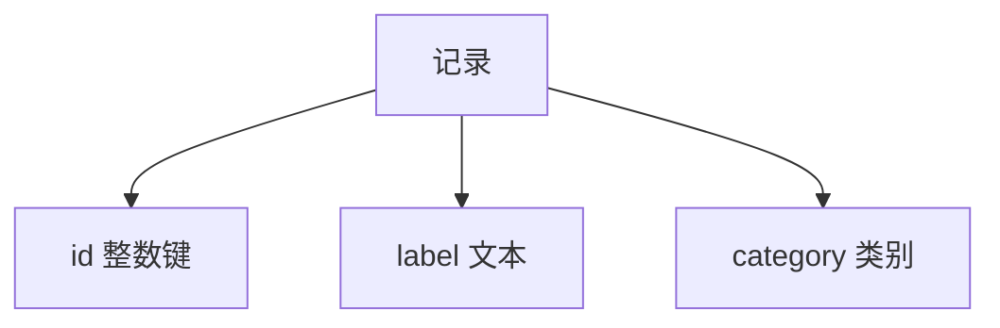
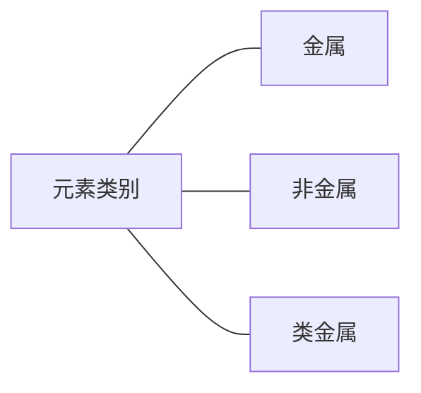
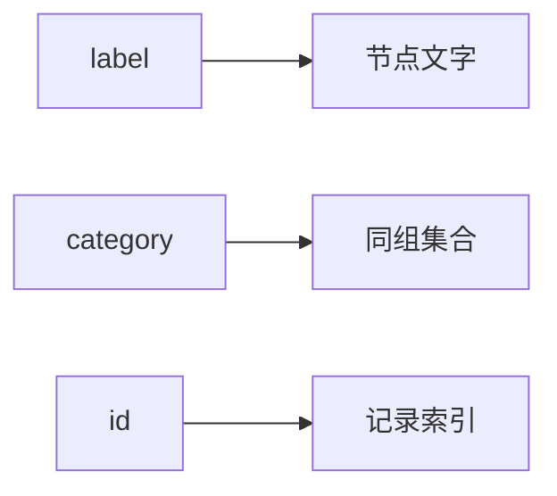
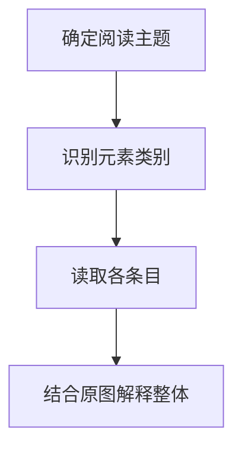
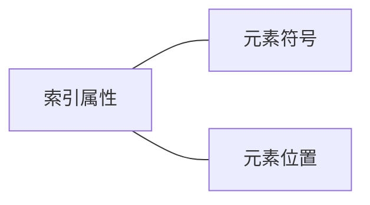
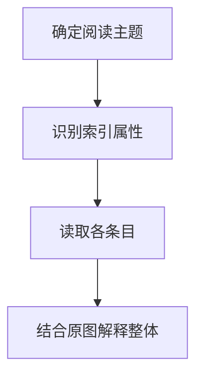

# 04｜字母表型信息图形 · 概念定义
**基础类型：字母表型（唯一五大基础类型之一）**｜版本：V1.0｜2026-11-19

## 定义
以**标准化名称或索引键的约定排序**组织信息，通过字母、拼音、笔画或其它事先声明的检索规则支持迅速查找。本质上是“**检索索引逻辑**”，而非信息之间存在自然的进程或等级。

## A｜基本的数据逻辑
结构为“条目 ID→检索键→规范排序键→分桶→内容”。
- A 排在 B 前，只是因为**检索规则**；不代表 A 更早、更重要或 A 导致 B。
- 同名不同实体要有唯一 ID；大小写、重音、简繁体、多音字、数字及别名等必须有可复核的排序与归一化规则。
- 中文可以采用拼音等索引键，原则是**统一检索标准**；不能把“按页面阅读顺序标号 A、B、C”误认为字母表型。
- 当条目主要按主题分类而非名称检索时，应归编目型；按重要程度阅读时应归层级型。

## B｜统计图形／计算方式
- 核心运算：文本标准化、排序、去重、分桶、检索匹配、交叉引用。
- 有数量资料才统计各字母/音节桶的条目数、词条出现频次、索引覆盖率等，并可借用点阵矩阵、长度条、频次柱形图。
- 排序序号不属于统计意义上的大小关系；**字母靠前不等于权重较高**，颜色渐变也不应暗示等级。

## C｜视觉编码
| 通道 | 作用 | 方法 |
|---|---|---|
| 点 | 词条标记、快速导航点 | 同等级词条保持一致尺寸 |
| 线 | 目录、跳转和索引导线 | 仅表示查找关系，不表示因果 |
| 面 | 字母桶、检索分区、卡片 | 采用稳定网格；面积不伪装词条数量 |
| 体 | 词条对象的立体示意 | 不宜成为阅读主路径 |
| 符号 | 词义及类别的辅助识别 | 符号不得替代文字检索键 |
| 色彩 | 字母段、分组 | 色彩只作导航辅助，不打乱检索顺序 |
| 文字 | 索引键、词条名、释义 | 突出首字母与条目标题，支持快速扫描 |

编码优先级：**可查找的键与分桶 > 词条清晰度 > 交叉链接 > 装饰**。

## D｜数据／信息架构
| item_id | display_name | sort_key | index_bucket | definition |
|---|---|---|---|---|
| T01 | 名称甲 | a01 | A | 解释甲 |
| T02 | 名称乙 | b01 | B | 解释乙 |
| T03 | 名称丙 | b02 | B | 解释丙 |

仅为抽象表示，sort_key 示例不是语言学排序标准。**一行一个词条；名称、排序键与正文分字段存储**。别名建立同义/关联链接，而不是重复制造多个词条实体。结构：索引入口→字母桶→词条→释义→相关词条。

## E｜视觉叙事架构
这类图形的主要体验是**用户主导的非线性检索**：知道目标名称→按键定位→读取摘要→跳转关联；不是作者规定的一条时间故事。可选推荐阅读路线属于附加导览，不能改变排序索引的主导性质。

---

# 案例验证与分析

以下案例内容从原有案例文档迁入本定义文档，保留原始图片链接、来源说明、数据摘录、清洗过程、字段结构、图形分析和叙事分析。案例证据用于检验和补充上面的类型定义；如案例仅为抽样或来源未完整转录，仍以原文限制说明为准。

# 04-字母表型：元素周期表

## 原图与来源

[作品发布页面](https://commons.wikimedia.org/wiki/File:Periodic_Table_Of_Elements.svg)；作者：Dmarcus100；授权：CC BY-SA 4.0。图像外链引用，未修改原图。

## 定义与选取依据
以字母或符号作为索引；严格字母排序须另行核对。本篇从该类型视角研究作品，部分案例为相邻类型参考而非严格典型。尤其字母表型需要另核对实际排序；手稿型研究拼贴中的历史手写材料，而非整个拼贴都属于手稿。

## 原始数据与清洗
依据作品发布说明抽取以下项目，非完整图内转录。

| 原始描述 | 规范标签 | 清洗规则 |
|---|---|---|
| 金属 | 金属 | 保留原义及近似标记，不补造数值 |
| 非金属 | 非金属 | 保留原义及近似标记，不补造数值 |
| 类金属 | 类金属 | 保留原义及近似标记，不补造数值 |

## 清洗后数据集
| id | label | category |
|---|---|---|
| 1 | 金属 | 元素类别 |
| 2 | 非金属 | 元素类别 |
| 3 | 类金属 | 元素类别 |

数据字典：id 为本地整数键；label 为来源描述的中文规范标签；category 为研究者标注的字段类别。缺失的原始量值不填零。

## 数据结构图

## 字段组合与统计方式
label 与 category 组成可分类检索的信息单元；id 与 label 提供唯一索引。本次抽取 3 条，不能代表原图全部数据。仅可统计抽样条目数，不可把类别计数误作实际对象数量或份额。

## 基础图形

上图用于展示来源说明中的条目集合，不声称各节点之间有直接因果或真实父子关系。无可验证的连续量值时，用定性图而非虚构统计柱图。

## 视觉编码图

## 叙事结构

## 设计总结与限制
以字母或符号作为索引；严格字母排序须另行核对。本图为发布说明支持的抽样分析，不是全量复刻。原图图例、完整数值及实际视觉编码需进一步逐项核对。Mermaid 图为自主分析图。

---

# 04-字母表型：书籍中的周期表

## 原图与来源

[作品发布页面](https://commons.wikimedia.org/wiki/File:Il_sistema_periodico.svg)；作者：Baba66；授权：CC0。图像外链引用，未修改原图。

## 定义与选取依据
以字母或符号作为索引；严格字母排序须另行核对。本篇从该类型视角研究作品，部分案例为相邻类型参考而非严格典型。尤其字母表型需要另核对实际排序；手稿型研究拼贴中的历史手写材料，而非整个拼贴都属于手稿。

## 原始数据与清洗
依据作品发布说明抽取以下项目，非完整图内转录。

| 原始描述 | 规范标签 | 清洗规则 |
|---|---|---|
| 元素符号 | 元素符号 | 保留原义及近似标记，不补造数值 |
| 元素位置 | 元素位置 | 保留原义及近似标记，不补造数值 |

## 清洗后数据集
| id | label | category |
|---|---|---|
| 1 | 元素符号 | 索引属性 |
| 2 | 元素位置 | 索引属性 |

数据字典：id 为本地整数键；label 为来源描述的中文规范标签；category 为研究者标注的字段类别。缺失的原始量值不填零。

## 数据结构图

## 字段组合与统计方式
label 与 category 组成可分类检索的信息单元；id 与 label 提供唯一索引。本次抽取 2 条，不能代表原图全部数据。仅可统计抽样条目数，不可把类别计数误作实际对象数量或份额。

## 基础图形

上图用于展示来源说明中的条目集合，不声称各节点之间有直接因果或真实父子关系。无可验证的连续量值时，用定性图而非虚构统计柱图。

## 视觉编码图

## 叙事结构

## 设计总结与限制
以字母或符号作为索引；严格字母排序须另行核对。本图为发布说明支持的抽样分析，不是全量复刻。原图图例、完整数值及实际视觉编码需进一步逐项核对。Mermaid 图为自主分析图。

