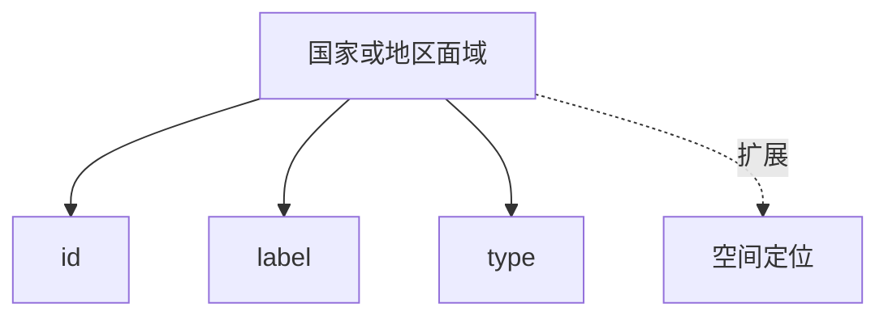
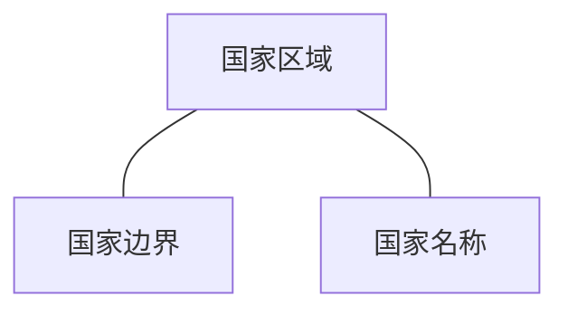
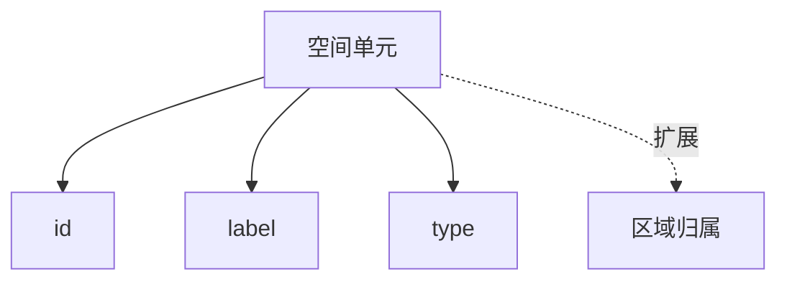
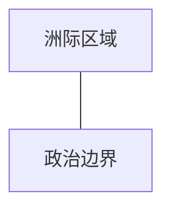
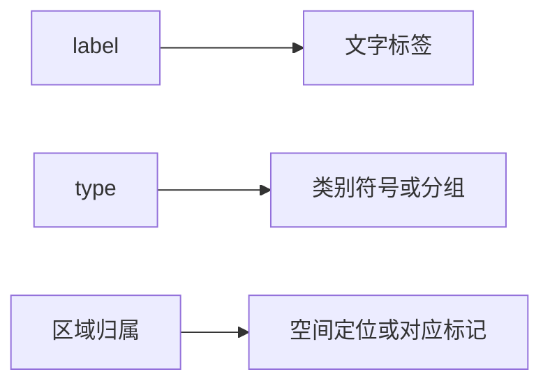

# 地理图形｜类型定义与基础设计逻辑

> 本文档定义该类型的信息组织本质、图形统计逻辑、视觉编码、信息架构与叙事方式。具体案例是否符合该类型，需回到原图、来源和实际数据逐项验证；不能把类型定义当作案例事实。

## A. 基本的数据逻辑：数据结构的本质

以空间位置和地理对象为主键；数据结构为带坐标的点、带路径的线或带边界的面，并关联属性表。

## B. 统计图形：统计方式与计算方式

点地图、比例符号地图、分级设色地图、流向图、等值线图、密度图；可计算密度、距离、邻近、空间聚合、比例和空间自相关，需说明投影与分母。

## C. 视觉编码：点、线、面、体、符号与色彩

点表示地点/事件；线表示道路、迁移或流向；面表示行政区/生态区；体积可表示三维量但需尺度说明；符号表示设施类别；色彩表示分类或连续强度并配图例。

## D. 数据／信息架构

空间数据与属性表通过地理ID连接；字段包括经纬度、几何、区域编码、时间、指标、单位、来源；处理坐标系、边界版本、空间精度、缺失坐标及聚合尺度。

## E. 视觉叙事架构

从整体区域定位主题，再聚焦热点、路径或区域差异，最后解释空间格局；避免把空间相关直接说成因果。

---

# 案例验证与分析

以下案例内容从原有案例文档迁入本定义文档，保留原始图片链接、来源说明、数据摘录、清洗过程、字段结构、图形分析和叙事分析。案例证据用于检验和补充上面的类型定义；如案例仅为抽样或来源未完整转录，仍以原文限制说明为准。

# 05-地理图形 · 带标签世界地图

## 1. 原始案例图片

[原始发布页及授权](https://commons.wikimedia.org/wiki/File:World_map_with_labels.svg)；作者：Wikideas1；授权：CC0。未修改原图。

## 2. 定义与特征

地理空间位置作为数据主索引，以点、线、面表现空间分布与边界。 名称定位区域，线划分边界；原始行政区数据来自 Eurostat GISCO。

## 3. 原始资料摘录与数据清洗

以下为发布说明支持的结构抽样及明确标记的研究者分析项，非完整原图转录。

| 原始描述或分析项 | 规范标签 | 类型 |
|---|---|---|
| 国家边界 | 国家边界 | 线 |
| 国家名称 | 国家名称 | 文字 |
| 国家区域 | 国家区域 | 面 |

清洗规则：去首尾空白，统一文本类型，保留标签语义；id 为新建本地键。缺失坐标、流量或数量保留为空，不补造。名称定位区域，线划分边界；原始行政区数据来自 Eurostat GISCO。

## 4. 清洗后数据集

| id | label | type |
|---:|---|---|
| 1 | 国家边界 | 线 |
| 2 | 国家名称 | 文字 |
| 3 | 国家区域 | 面 |

数据字典：id（整数，本地唯一键）；label（文本，国家或地区面域名称或分析项）；type（分类文本，研究者归类）。国家名称与空间定位可作为后续扩展字段，未知量值不填零。

## 5. 数据结构

## 6. 字段组合与统计

label + type 用于区分对象；id + label 用于索引；扩展关系字段用于组织对象联系。此次抽样为 3 条，不能代表原作对象总数。定性数据无需强行使用均值或占比。

## 7. 基础图形与统计图形

名称定位区域，线划分边界；原始行政区数据来自 Eurostat GISCO。 此图为研究分析示意，不是等比例地图或数量流图。RAWGraphs 推荐：有真实经纬度时采用点地图或区域地图；地理位置不可用普通类别排序替代。

## 8. 视觉编码映射图

## 9. 叙事结构

## 10. 设计总结与限制

地理空间位置作为数据主索引，以点、线、面表现空间分布与边界。 原图链接已查到公开发布记录；当前为定性分析，未完成全图逐项校对及 GitHub 实际渲染验证。

---

# 05-地理图形 · 洲际与政治边界地图

## 1. 原始案例图片

[原始发布页及授权](https://commons.wikimedia.org/wiki/File:World_Map_with_continents_and_borders.png)；作者：ChristianPluto；授权：CC0。未修改原图。

## 2. 定义与特征

地理空间位置作为数据主索引，以点、线、面表现空间分布与边界。 洲与行政边界构成两个尺度的地理信息层，不能把行政边界当成洲界。

## 3. 原始资料摘录与数据清洗

以下为发布说明支持的结构抽样及明确标记的研究者分析项，非完整原图转录。

| 原始描述或分析项 | 规范标签 | 类型 |
|---|---|---|
| 洲际区域 | 洲际区域 | 面 |
| 政治边界 | 政治边界 | 线 |

清洗规则：去首尾空白，统一文本类型，保留标签语义；id 为新建本地键。缺失坐标、流量或数量保留为空，不补造。洲与行政边界构成两个尺度的地理信息层，不能把行政边界当成洲界。

## 4. 清洗后数据集

| id | label | type |
|---:|---|---|
| 1 | 洲际区域 | 面 |
| 2 | 政治边界 | 线 |

数据字典：id（整数，本地唯一键）；label（文本，空间单元名称或分析项）；type（分类文本，研究者归类）。边界层与区域归属可作为后续扩展字段，未知量值不填零。

## 5. 数据结构

## 6. 字段组合与统计

label + type 用于区分对象；id + label 用于索引；扩展关系字段用于组织对象联系。此次抽样为 2 条，不能代表原作对象总数。定性数据无需强行使用均值或占比。

## 7. 基础图形与统计图形

洲与行政边界构成两个尺度的地理信息层，不能把行政边界当成洲界。 此图为研究分析示意，不是等比例地图或数量流图。RAWGraphs 推荐：有真实经纬度时采用点地图或区域地图；地理位置不可用普通类别排序替代。

## 8. 视觉编码映射图

## 9. 叙事结构

## 10. 设计总结与限制

地理空间位置作为数据主索引，以点、线、面表现空间分布与边界。 原图链接已查到公开发布记录；当前为定性分析，未完成全图逐项校对及 GitHub 实际渲染验证。

