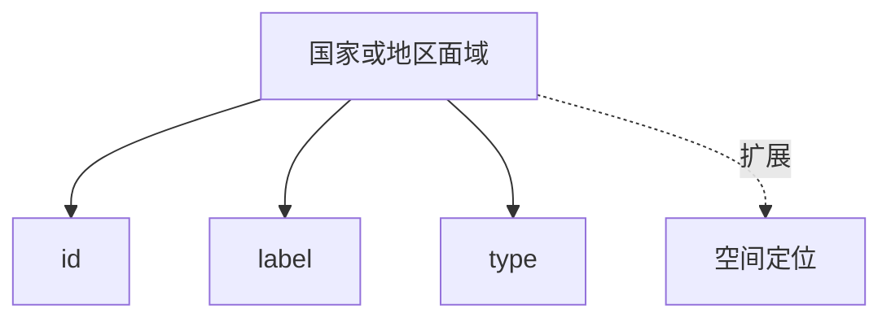
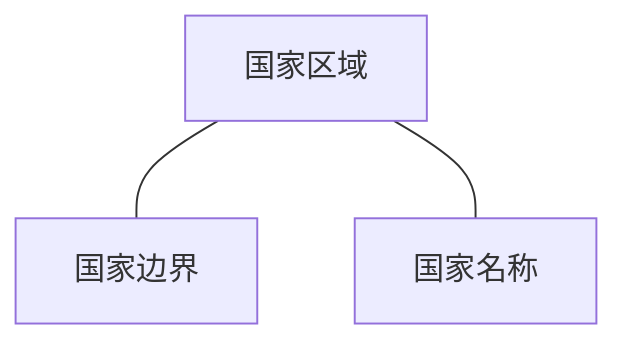
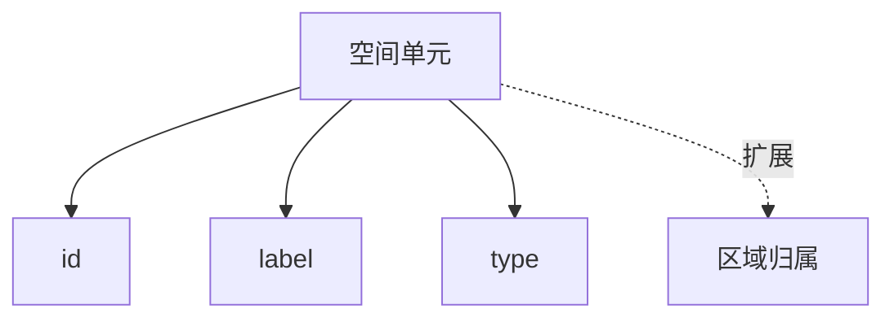
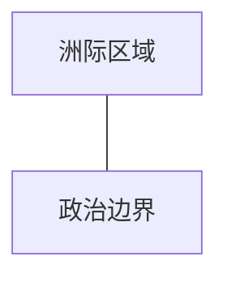
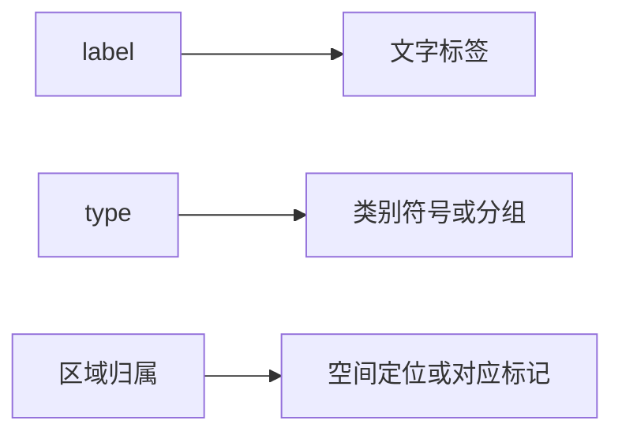

# 05｜地理图型信息图形 · 概念定义
**基础类型：地理图型（唯一五大基础类型之一）**｜版本：V1.1｜2026-11-20

## 定义
以**空间位置、区域、相邻、距离、方位或地理连接**为组织关系，使读者解释“在哪里、如何分布、相隔/连接怎样”。画了地图图标不构成地理组织；地理关系必须参与信息组织或推断。

## A｜基本的数据逻辑
三类常见空间关系：
- **点位定位**：object_id→coordinates；强调具体位置与相对分布。
- **区域分组**：region_id→geometry→属性值；强调不同区域的差异、包含及相邻。
- **路径/流向**：origin_id、destination_id、route_id、flow_value；强调空间联系、通行和流动。
核心约束是**空间参照与空间关系不可任意替换**；地图形状有装饰性但数据不带位置键时，不判为地理图型。位置数据可与时间序列、类别比较叠加，但基础主归属依据作品首要解释的问题确定。

## B｜统计图形／计算方式
- 常用：地理编码、坐标系变换、空间连接 Spatial Join、距离计算、邻接表、区域聚合、密度/比率、路径统计。
- 可用：点位地图、分级设色 Choropleth、比例符号图、路线图、OD 流向图、格网图、空间小倍数图。
- 定量注意：地区原始总量易受人口/面积影响；密度须给分母和口径；地图投影可能改变面积与距离；线宽和气泡大小表达数量时必须校准；未经验证的热度效果不是空间密度估计。

## C｜视觉编码
| 通道 | 作用 | 方法 |
|---|---|---|
| 点 | 地点、事件位置、设施 | 位置依据坐标；点面积映射数值时按面积比例 |
| 线 | 地理边界、路径、流向 | 不同线型分清行政边界与实际移动 |
| 面 | 行政区、研究区、密度或覆盖 | 离散区域按类别、连续值按统一色阶 |
| 体 | 地形、城市、地标空间示意 | 仅辅助环境解读，不用任意高度假造数值 |
| 符号 | 设施种类、地点身份 | 具备可读图例；稠密场景做可审计聚合 |
| 色彩 | 类别或连续/发散量值 | 统一映射并标单位，慎用未经解释的渐变 |
| 文字 | 地名、方向、尺度、数据口径 | 地名不遮挡数据，提供来源与时期 |

编码优先级：**空间定位与几何准确 > 变量的量纲映射 > 符号识别 > 美化**。

## D｜数据／信息架构
区域型最小表（空间几何须另有真实数据源）：
| region_id | geometry_id | count | denominator | period |
|---|---|---:|---:|---|
| R01 | G01 | 120 | 10000 | P1 |
| R02 | G02 | 90 | 6000 | P1 |

该表数值仅用作字段示意，不是实际地区记录。**一行一个空间观测单元**；时序对比按“空间单元×时期”扩展。点位型需要 latitude、longitude、CRS；路径型采用边表或 OD 表。数据处理链：地理参照→空间连接→量纲统一→视图分层→地图解释。

## E｜视觉叙事架构
**整体地理范围→关键空间格局→局部热点或路径→区域差异解释→回归全局**。路线类可用“起点→途经→终点”讲述旅程，但主导组织依据仍是空间路线；不得只因有箭头就改判编年型。

---

# 案例验证与分析

以下案例内容从原有案例文档迁入本定义文档，保留原始图片链接、来源说明、数据摘录、清洗过程、字段结构、图形分析和叙事分析。案例证据用于检验和补充上面的类型定义；如案例仅为抽样或来源未完整转录，仍以原文限制说明为准。

# 05-地理图形 · 带标签世界地图

## 1. 原始案例图片

[原始发布页及授权](https://commons.wikimedia.org/wiki/File:World_map_with_labels.svg)；作者：Wikideas1；授权：CC0。未修改原图。

## 2. 定义与特征

地理空间位置作为数据主索引，以点、线、面表现空间分布与边界。 名称定位区域，线划分边界；原始行政区数据来自 Eurostat GISCO。

## 3. 原始资料摘录与数据清洗

以下为发布说明支持的结构抽样及明确标记的研究者分析项，非完整原图转录。

| 原始描述或分析项 | 规范标签 | 类型 |
|---|---|---|
| 国家边界 | 国家边界 | 线 |
| 国家名称 | 国家名称 | 文字 |
| 国家区域 | 国家区域 | 面 |

清洗规则：去首尾空白，统一文本类型，保留标签语义；id 为新建本地键。缺失坐标、流量或数量保留为空，不补造。名称定位区域，线划分边界；原始行政区数据来自 Eurostat GISCO。

## 4. 清洗后数据集

| id | label | type |
|---:|---|---|
| 1 | 国家边界 | 线 |
| 2 | 国家名称 | 文字 |
| 3 | 国家区域 | 面 |

数据字典：id（整数，本地唯一键）；label（文本，国家或地区面域名称或分析项）；type（分类文本，研究者归类）。国家名称与空间定位可作为后续扩展字段，未知量值不填零。

## 5. 数据结构

## 6. 字段组合与统计

label + type 用于区分对象；id + label 用于索引；扩展关系字段用于组织对象联系。此次抽样为 3 条，不能代表原作对象总数。定性数据无需强行使用均值或占比。

## 7. 基础图形与统计图形

名称定位区域，线划分边界；原始行政区数据来自 Eurostat GISCO。 此图为研究分析示意，不是等比例地图或数量流图。RAWGraphs 推荐：有真实经纬度时采用点地图或区域地图；地理位置不可用普通类别排序替代。

## 8. 视觉编码映射图

## 9. 叙事结构

## 10. 设计总结与限制

地理空间位置作为数据主索引，以点、线、面表现空间分布与边界。 原图链接已查到公开发布记录；当前为定性分析，未完成全图逐项校对及 GitHub 实际渲染验证。

---

# 05-地理图形 · 洲际与政治边界地图

## 1. 原始案例图片

[原始发布页及授权](https://commons.wikimedia.org/wiki/File:World_Map_with_continents_and_borders.png)；作者：ChristianPluto；授权：CC0。未修改原图。

## 2. 定义与特征

地理空间位置作为数据主索引，以点、线、面表现空间分布与边界。 洲与行政边界构成两个尺度的地理信息层，不能把行政边界当成洲界。

## 3. 原始资料摘录与数据清洗

以下为发布说明支持的结构抽样及明确标记的研究者分析项，非完整原图转录。

| 原始描述或分析项 | 规范标签 | 类型 |
|---|---|---|
| 洲际区域 | 洲际区域 | 面 |
| 政治边界 | 政治边界 | 线 |

清洗规则：去首尾空白，统一文本类型，保留标签语义；id 为新建本地键。缺失坐标、流量或数量保留为空，不补造。洲与行政边界构成两个尺度的地理信息层，不能把行政边界当成洲界。

## 4. 清洗后数据集

| id | label | type |
|---:|---|---|
| 1 | 洲际区域 | 面 |
| 2 | 政治边界 | 线 |

数据字典：id（整数，本地唯一键）；label（文本，空间单元名称或分析项）；type（分类文本，研究者归类）。边界层与区域归属可作为后续扩展字段，未知量值不填零。

## 5. 数据结构

## 6. 字段组合与统计

label + type 用于区分对象；id + label 用于索引；扩展关系字段用于组织对象联系。此次抽样为 2 条，不能代表原作对象总数。定性数据无需强行使用均值或占比。

## 7. 基础图形与统计图形

洲与行政边界构成两个尺度的地理信息层，不能把行政边界当成洲界。 此图为研究分析示意，不是等比例地图或数量流图。RAWGraphs 推荐：有真实经纬度时采用点地图或区域地图；地理位置不可用普通类别排序替代。

## 8. 视觉编码映射图

## 9. 叙事结构

## 10. 设计总结与限制

地理空间位置作为数据主索引，以点、线、面表现空间分布与边界。 原图链接已查到公开发布记录；当前为定性分析，未完成全图逐项校对及 GitHub 实际渲染验证。

