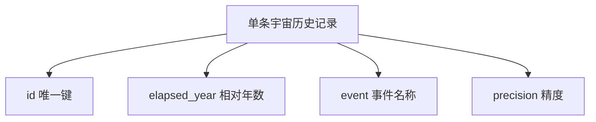
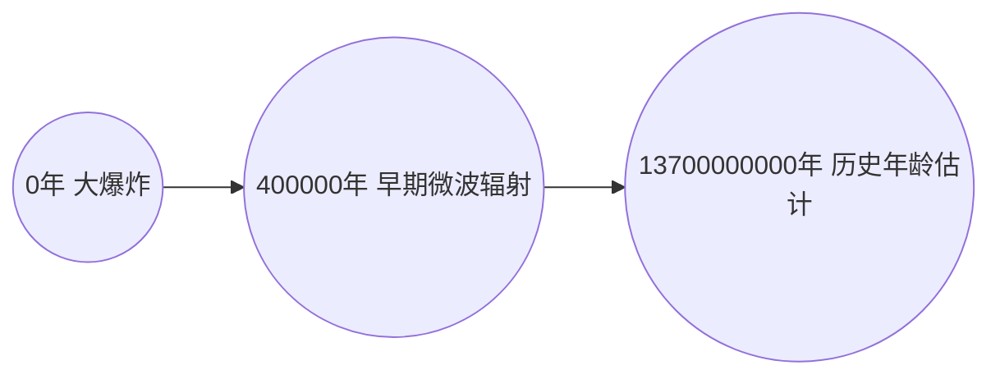
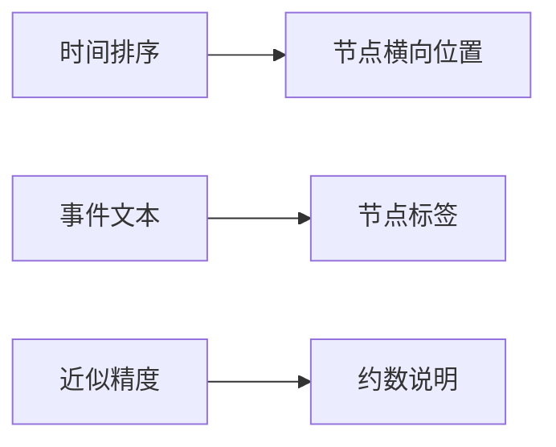
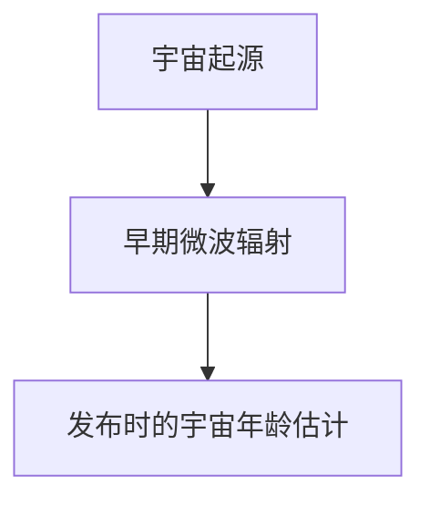

# 编年型 · 案例A：宇宙历史

## 原始图片与来源

[原始作品与授权](https://commons.wikimedia.org/wiki/File:Timeline_of_the_Universe.jpg)；NASA/JPL-Caltech。数据来自作品发布页说明，非完整图内转录。

## 原始数据

| 时间描述 | 事件 |
|---|---|
| Big Bang | 大爆炸 |
| 约40万年 | 早期微波辐射 |
| 约137亿年 | 发布时估计的宇宙年龄 |

## 数据清洗

| 原始值 | 清洗值 | 规则 |
|---|---:|---|
| Big Bang | 0 | 定义相对起点 |
| 约40万年 | 400000 | 统一为年，保留近似性质 |
| 约137亿年 | 13700000000 | 亿转换为数值，保留历史估计口径 |

## 清洗后数据集与数据字典

| id | elapsed_year | event | precision |
|---|---:|---|---|
| E01 | 0 | 大爆炸 | 定义起点 |
| E02 | 400000 | 早期微波辐射 | 约数 |
| E03 | 13700000000 | 发布时的宇宙年龄 | 约数 |

id：文本唯一键；elapsed_year：相对大爆炸的年数，整数；event：文本标签；precision：精度类别。未获来源支持的阶段数值不补写。

## 数据结构与字段组合含义

时间＋事件构成历史顺序；时间＋精度区分定义起点和近似估计。按时间升序排序。

## 统计图形与视觉编码

### 基础图形：阶段时间轴

节点间距不是时间比例。原图属于历史示意，不能将事件数当成宇宙物理量。RAWGraphs 可用散点图表达定量时间位置，以 elapsed_year 为 X，固定 Y 为辅助常量，event 为标签；不需要求和或平均。

### 视觉编码图

## 叙事结构

## 设计总结

时间作为主索引，节点标注事件，连接线表达先后；区分顺序轴与等比例时间轴。当前为发布页可核实数据的子集，非完整原图复刻。
