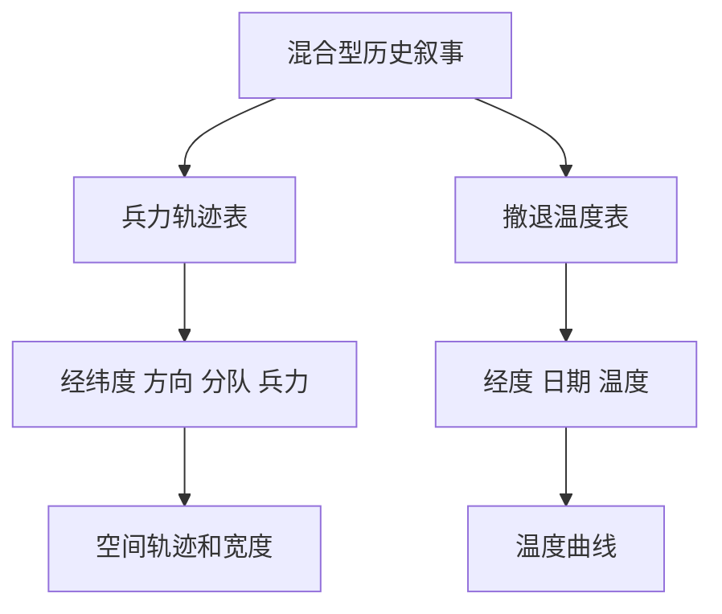
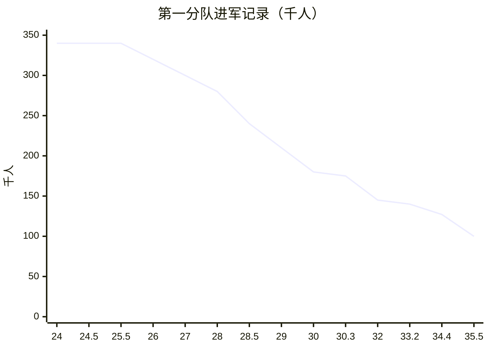
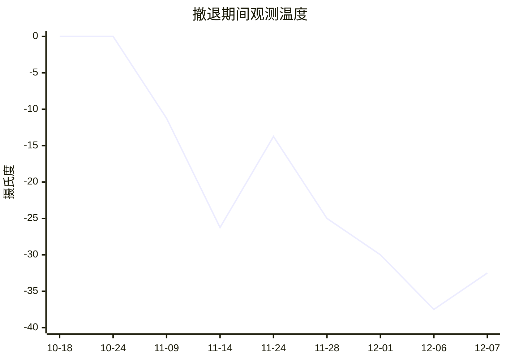

# 混合型案例A：米纳尔俄国远征图（1869）

作者：Charles Joseph Minard，1869年11月20日，公有领域。[原图发布页](https://commons.wikimedia.org/wiki/File:Minard.png)；[机器可读数据](https://github.com/stdlib-js/datasets-minard-napoleons-march)；[HistData 数据字典](https://friendly.github.io/HistData/reference/Minard.html)。

## 定义与选取依据
混合型同时组织空间、数量、分类与时间。本图把进退路径、兵力、方向及撤退温度组合为同一历史叙事。

## 原始数据与清洗前后
以下是公开转录中第一分队进军的前14个记录，并非全部51条兵力记录；温度表为全部9条。原始字段 lon、lat、size、direction=A、division=1。清洗时保留坐标，不把分队人数混同总兵力，不对重复人数去重；增加千人单位用于图表。

| lon | lat | size（人） | direction | division | 清洗后兵力（千人） |
|---:|---:|---:|---|---:|---:|
| 24 | 54.9 | 340000 | A | 1 | 340 |
| 24.5 | 55 | 340000 | A | 1 | 340 |
| 25.5 | 54.5 | 340000 | A | 1 | 340 |
| 26 | 54.7 | 320000 | A | 1 | 320 |
| 27 | 54.8 | 300000 | A | 1 | 300 |
| 28 | 54.9 | 280000 | A | 1 | 280 |
| 28.5 | 55 | 240000 | A | 1 | 240 |
| 29 | 55.1 | 210000 | A | 1 | 210 |
| 30 | 55.2 | 180000 | A | 1 | 180 |
| 30.3 | 55.3 | 175000 | A | 1 | 175 |
| 32 | 54.8 | 145000 | A | 1 | 145 |
| 33.2 | 54.9 | 140000 | A | 1 | 140 |
| 34.4 | 55.5 | 127100 | A | 1 | 127.1 |
| 35.5 | 55.4 | 100000 | A | 1 | 100 |

## 清洗后温度数据
原图温标为列氏，摄氏值=列氏值×1.25；日期统一为 ISO 格式。来源日期按1812年记录。

| 经度 | 原始日期 | 原始温度 °Ré | 清洗日期 | 温度 °C |
|---:|---|---:|---|---:|
| 37.6 | 18 Oct 1812 | 0 | 1812-10-18 | 0 |
| 36 | 24 Oct 1812 | 0 | 1812-10-24 | 0 |
| 33.2 | 09 Nov 1812 | -9 | 1812-11-09 | -11.25 |
| 32 | 14 Nov 1812 | -21 | 1812-11-14 | -26.25 |
| 29.2 | 24 Nov 1812 | -11 | 1812-11-24 | -13.75 |
| 28.5 | 28 Nov 1812 | -20 | 1812-11-28 | -25 |
| 27.2 | 01 Dec 1812 | -24 | 1812-12-01 | -30 |
| 26.7 | 06 Dec 1812 | -30 | 1812-12-06 | -37.5 |
| 25.3 | 07 Dec 1812 | -26 | 1812-12-07 | -32.5 |

## 数据字典与结构
lon/lat：数值坐标（度）；size：整数（人）；direction：分类（A进军、R撤退）；division：分队编号；date：日期；temp：列氏温度；temp_c：摄氏温度；size_k：千人为单位的兵力。兵力表和温度表的粒度不同，经度只能辅助空间对齐，不能直接作唯一键连接。

## 统计图形：兵力变化

横轴为按经度递增的等距类别，不代表实际距离。首末抽样记录减少240000人，下降70.59%；不是全军死亡率。

## 统计图形：撤退温度

观测日期等距显示，不代表真实时间间隔。最低记录为12月6日，-37.5°C。

## 视觉编码与字段组合
| 字段组合 | 信息含义 | 原图或再设计编码 |
|---|---|---|
| lon + lat | 行军空间轨迹 | 原图路径位置 |
| size + direction | 兵力规模与进退 | 原图带宽、棕/黑颜色 |
| division + 坐标 | 分队路径 | 独立路径分组 |
| date + temp_c | 撤退期间温度变化 | 再设计折线位置 |
| 经度 + 两表 | 地理上的温度与兵力联系 | 对齐视图，不证明因果 |

原图每毫米带宽对应10000人；棕色进军、黑色撤退。再设计采用折线分离变量，以便精确阅读。RAWGraphs 可选线图；原图变宽地理轨迹不能用普通桑基图完全复刻。

## 叙事结构

## 基础设计规律
先确定空间主索引，再用宽度承载量值，以颜色区分方向，通过辅助图共享空间参照。区分时间相关与因果。当前兵力表为明确限定的14条子集，尚非完整复刻；未验证GitHub实际图表渲染。
