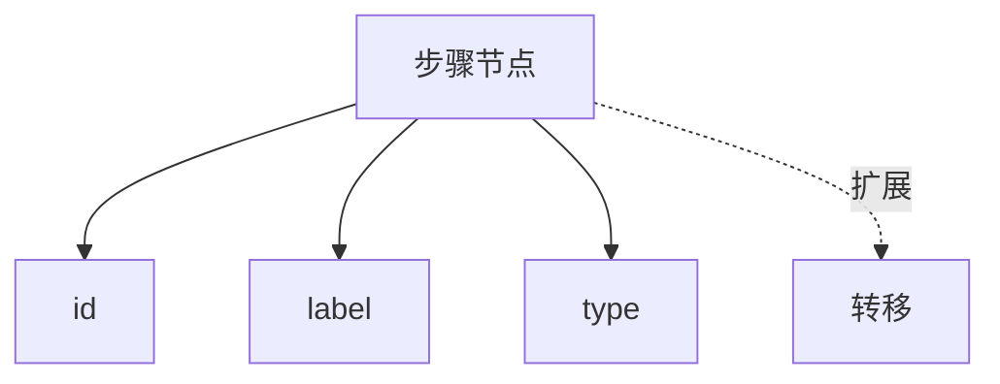
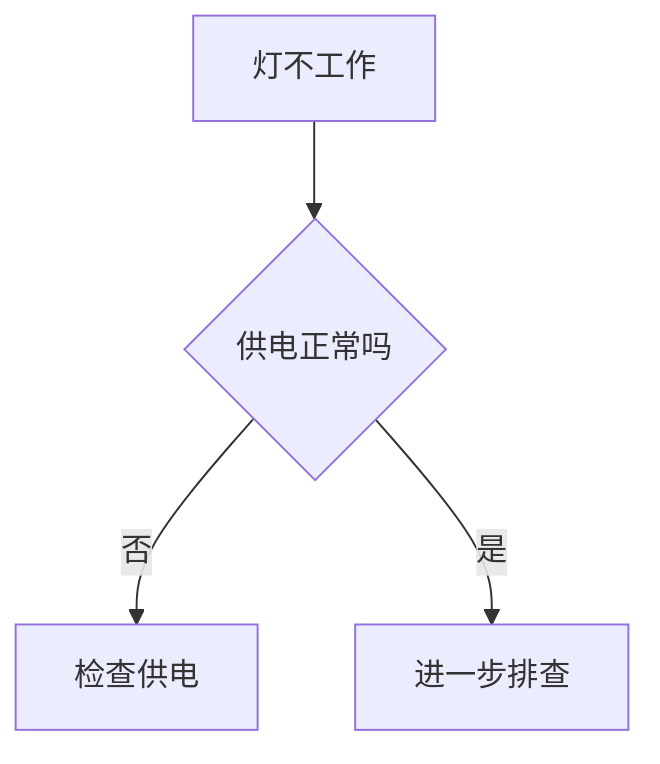
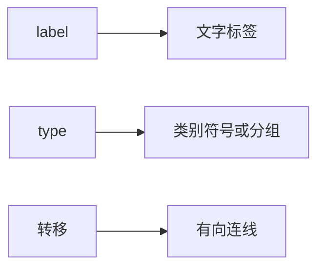

# 10-流程图型 · 灯具故障排查

## 1. 原始案例图片

[原始发布页及授权](https://commons.wikimedia.org/wiki/File:Lava_lamp_flowchart.svg)；作者：Tels~enwiki；授权：CC BY-SA 3.0。未修改原图。

## 2. 定义与特征

以节点表示状态或操作，以有向边表示步骤转移、选择或循环。 发布说明确认主题为灯具故障排查；具体判断和操作为研究者提供的简化示范，未逐节点转录原图。

## 3. 原始资料摘录与数据清洗

以下为发布说明支持的结构抽样及明确标记的研究者分析项，非完整原图转录。

| 原始描述或分析项 | 规范标签 | 类型 |
|---|---|---|
| 灯不工作 | 灯不工作 | 起始状态 |
| 检查供电 | 检查供电 | 判断示例 |
| 采取处理措施 | 采取处理措施 | 操作示例 |

清洗规则：去首尾空白，统一文本类型，保留标签语义；id 为新建本地键。缺失坐标、流量或数量保留为空，不补造。发布说明确认主题为灯具故障排查；具体判断和操作为研究者提供的简化示范，未逐节点转录原图。

## 4. 清洗后数据集

| id | label | type |
|---:|---|---|
| 1 | 灯不工作 | 起始状态 |
| 2 | 检查供电 | 判断示例 |
| 3 | 采取处理措施 | 操作示例 |

数据字典：id（整数，本地唯一键）；label（文本，步骤节点名称或分析项）；type（分类文本，研究者归类）。条件与转移可作为后续扩展字段，未知量值不填零。

## 5. 数据结构

## 6. 字段组合与统计

label + type 用于区分对象；id + label 用于索引；扩展关系字段用于组织对象联系。此次抽样为 3 条，不能代表原作对象总数。定性数据无需强行使用均值或占比。

## 7. 基础图形与统计图形

发布说明确认主题为灯具故障排查；具体判断和操作为研究者提供的简化示范，未逐节点转录原图。 此图为研究分析示意，不是等比例地图或数量流图。RAWGraphs 推荐：有真实流量时采用桑基图，来源、去向、权重分别映射；无权重时采用有向流程关系图。

## 8. 视觉编码映射图

## 9. 叙事结构

## 10. 设计总结与限制

以节点表示状态或操作，以有向边表示步骤转移、选择或循环。 原图链接已查到公开发布记录；当前为定性分析，未完成全图逐项校对及 GitHub 实际渲染验证。
