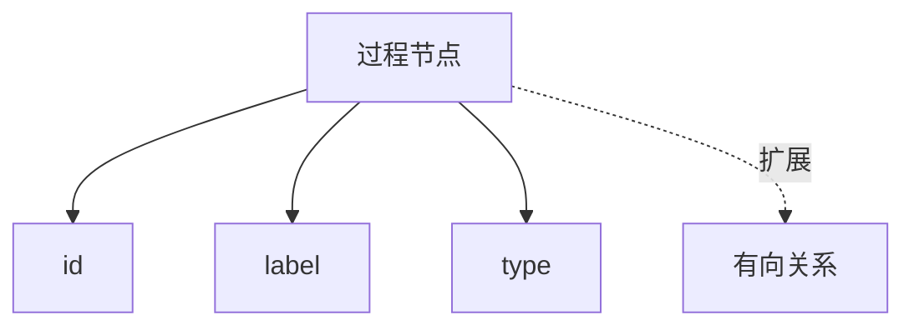
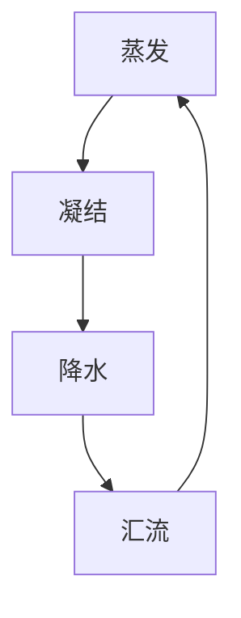
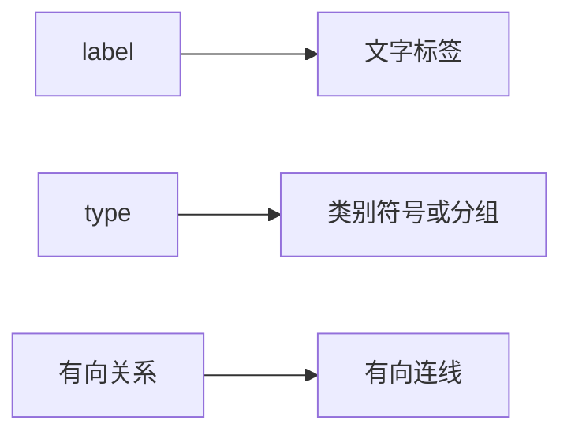

# 10-流程图型 · 水循环流程图

## 1. 原始案例图片

[原始发布页及授权](https://commons.wikimedia.org/wiki/File:Water_cycle_flowchart.png)；作者：Entropyrider；授权：CC0。未修改原图。

## 2. 定义与特征

以节点表示状态或操作，以有向边表示步骤转移、选择或循环。 发布说明确认主题为水循环；四个过程为通用水循环简化模型，不声称为原图完整标签或全部路径。

## 3. 原始资料摘录与数据清洗

以下为发布说明支持的结构抽样及明确标记的研究者分析项，非完整原图转录。

| 原始描述或分析项 | 规范标签 | 类型 |
|---|---|---|
| 蒸发 | 蒸发 | 过程 |
| 凝结 | 凝结 | 过程 |
| 降水 | 降水 | 过程 |
| 汇流 | 汇流 | 过程 |

清洗规则：去首尾空白，统一文本类型，保留标签语义；id 为新建本地键。缺失坐标、流量或数量保留为空，不补造。发布说明确认主题为水循环；四个过程为通用水循环简化模型，不声称为原图完整标签或全部路径。

## 4. 清洗后数据集

| id | label | type |
|---:|---|---|
| 1 | 蒸发 | 过程 |
| 2 | 凝结 | 过程 |
| 3 | 降水 | 过程 |
| 4 | 汇流 | 过程 |

数据字典：id（整数，本地唯一键）；label（文本，过程节点名称或分析项）；type（分类文本，研究者归类）。过程名称与有向关系可作为后续扩展字段，未知量值不填零。

## 5. 数据结构

## 6. 字段组合与统计

label + type 用于区分对象；id + label 用于索引；扩展关系字段用于组织对象联系。此次抽样为 4 条，不能代表原作对象总数。定性数据无需强行使用均值或占比。

## 7. 基础图形与统计图形

发布说明确认主题为水循环；四个过程为通用水循环简化模型，不声称为原图完整标签或全部路径。 此图为研究分析示意，不是等比例地图或数量流图。RAWGraphs 推荐：有真实流量时采用桑基图，来源、去向、权重分别映射；无权重时采用有向流程关系图。

## 8. 视觉编码映射图

## 9. 叙事结构

## 10. 设计总结与限制

以节点表示状态或操作，以有向边表示步骤转移、选择或循环。 原图链接已查到公开发布记录；当前为定性分析，未完成全图逐项校对及 GitHub 实际渲染验证。
