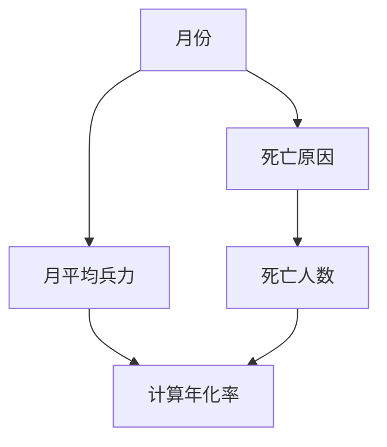
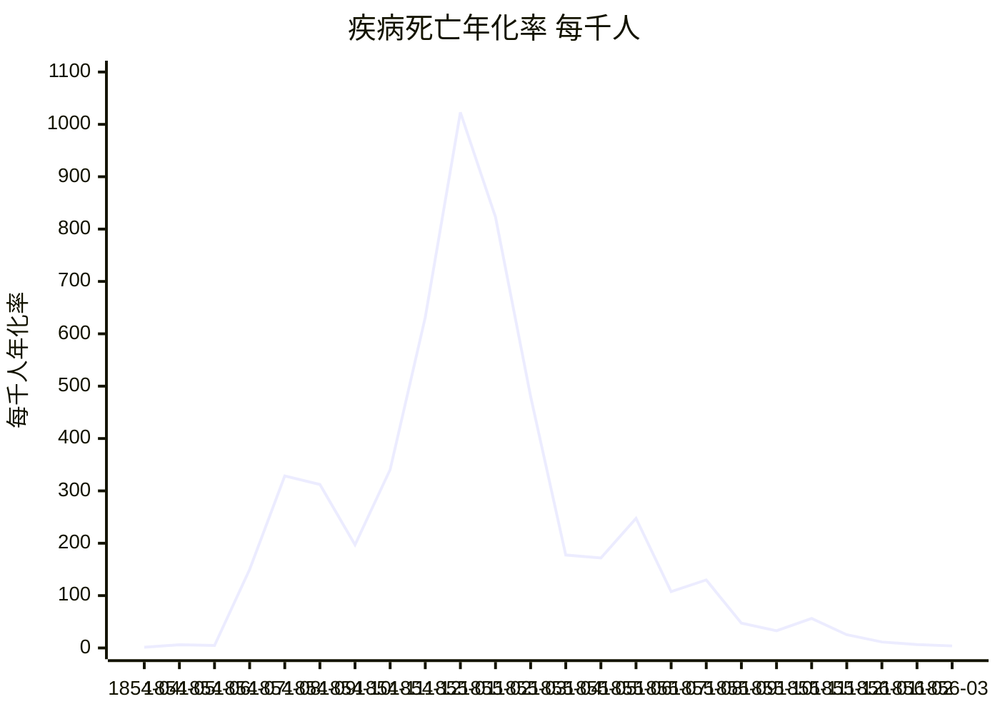
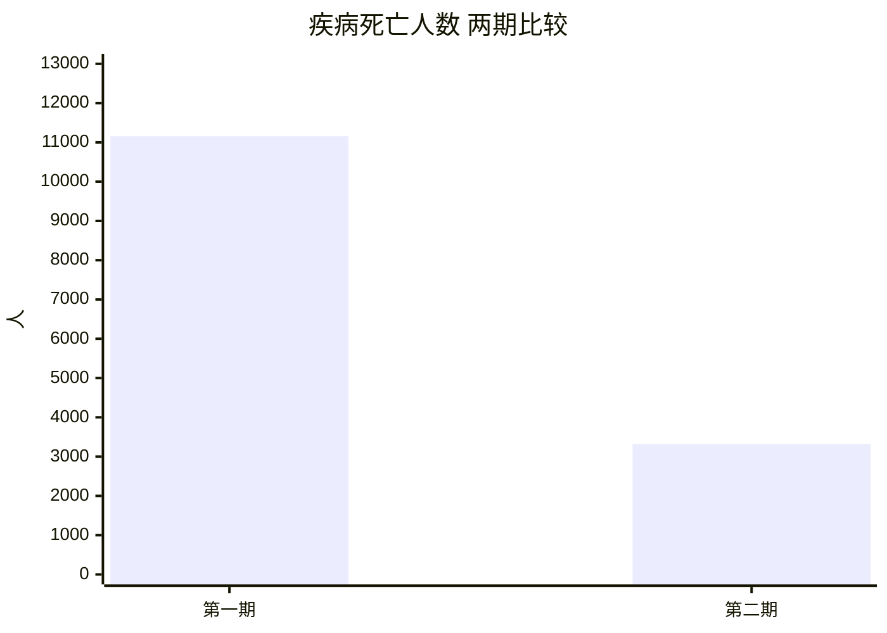

# 比较型案例A：南丁格尔死亡原因图（1858）

[原图及授权](https://commons.wikimedia.org/wiki/File:Nightingale-mortality.jpg)，Florence Nightingale，1858，历史公版作品。[24个月完整数据表](https://svhs.co/lesson/ri-11-12-7/)；[HistData 数据说明](https://r-observatory.thecoatlessprofessor.com/datasets/HistData/Nightingale)；[爱荷华大学数据核对](https://homepage.stat.uiowa.edu/~luke/classes/STAT4580/miscone.html)。

## 定义及特征
比较型通过统一尺度让读者对照类别及时期。原图使用两幅极坐标面积图比较连续两个年度的三种死亡原因，而非普通饼图。

## 原始数据和清洗
原始英文月份与年份合并为 YYYY-MM，人数去千位分隔符并转整数；Army 是月平均兵力而非累计人口，零死亡保留为零。1854年7月兵力采用大学示例及 HistData 转录的28722，而非另一转载的28772。以下为全部24个月的核心字段。

|原始月份|月平均兵力|疾病|伤亡|其他|
|---|---:|---:|---:|---:|
| Apr 1854 | 8571 | 1 | 0 | 5 |
| May 1854 | 23333 | 12 | 0 | 9 |
| Jun 1854 | 28333 | 11 | 0 | 6 |
| Jul 1854 | 28722 | 359 | 0 | 23 |
| Aug 1854 | 30246 | 828 | 1 | 30 |
| Sep 1854 | 30290 | 788 | 81 | 70 |
| Oct 1854 | 30643 | 503 | 132 | 128 |
| Nov 1854 | 29736 | 844 | 287 | 106 |
| Dec 1854 | 32779 | 1725 | 114 | 131 |
| Jan 1855 | 32393 | 2761 | 83 | 324 |
| Feb 1855 | 30919 | 2120 | 42 | 361 |
| Mar 1855 | 30107 | 1205 | 32 | 172 |
| Apr 1855 | 32252 | 477 | 48 | 57 |
| May 1855 | 35473 | 508 | 49 | 37 |
| Jun 1855 | 38863 | 802 | 209 | 31 |
| Jul 1855 | 42647 | 382 | 134 | 33 |
| Aug 1855 | 44614 | 483 | 164 | 25 |
| Sep 1855 | 47751 | 189 | 276 | 20 |
| Oct 1855 | 46852 | 128 | 53 | 18 |
| Nov 1855 | 37853 | 178 | 33 | 32 |
| Dec 1855 | 43217 | 91 | 18 | 28 |
| Jan 1856 | 44212 | 42 | 2 | 48 |
| Feb 1856 | 43485 | 24 | 0 | 19 |
| Mar 1856 | 46140 | 15 | 0 | 35 |

## 清洗后数据集
三类年化死亡率 = 当月死亡人数 / 当月平均兵力 × 12000，单位为每千人年化死亡数，保留一位小数。非实际全年死亡概率。

|month|army|disease|wounds|other|disease_rate|wounds_rate|other_rate|total|
|---|---:|---:|---:|---:|---:|---:|---:|---:|
| 1854-04 | 8571 | 1 | 0 | 5 | 1.4 | 0 | 7 | 6 |
| 1854-05 | 23333 | 12 | 0 | 9 | 6.2 | 0 | 4.6 | 21 |
| 1854-06 | 28333 | 11 | 0 | 6 | 4.7 | 0 | 2.5 | 17 |
| 1854-07 | 28722 | 359 | 0 | 23 | 150 | 0 | 9.6 | 382 |
| 1854-08 | 30246 | 828 | 1 | 30 | 328.5 | 0.4 | 11.9 | 859 |
| 1854-09 | 30290 | 788 | 81 | 70 | 312.2 | 32.1 | 27.7 | 939 |
| 1854-10 | 30643 | 503 | 132 | 128 | 197 | 51.7 | 50.1 | 763 |
| 1854-11 | 29736 | 844 | 287 | 106 | 340.6 | 115.8 | 42.8 | 1237 |
| 1854-12 | 32779 | 1725 | 114 | 131 | 631.5 | 41.7 | 48 | 1970 |
| 1855-01 | 32393 | 2761 | 83 | 324 | 1022.8 | 30.7 | 120 | 3168 |
| 1855-02 | 30919 | 2120 | 42 | 361 | 822.8 | 16.3 | 140.1 | 2523 |
| 1855-03 | 30107 | 1205 | 32 | 172 | 480.3 | 12.8 | 68.6 | 1409 |
| 1855-04 | 32252 | 477 | 48 | 57 | 177.5 | 17.9 | 21.2 | 582 |
| 1855-05 | 35473 | 508 | 49 | 37 | 171.8 | 16.6 | 12.5 | 594 |
| 1855-06 | 38863 | 802 | 209 | 31 | 247.6 | 64.5 | 9.6 | 1042 |
| 1855-07 | 42647 | 382 | 134 | 33 | 107.5 | 37.7 | 9.3 | 549 |
| 1855-08 | 44614 | 483 | 164 | 25 | 129.9 | 44.1 | 6.7 | 672 |
| 1855-09 | 47751 | 189 | 276 | 20 | 47.5 | 69.4 | 5 | 485 |
| 1855-10 | 46852 | 128 | 53 | 18 | 32.8 | 13.6 | 4.6 | 199 |
| 1855-11 | 37853 | 178 | 33 | 32 | 56.4 | 10.5 | 10.1 | 243 |
| 1855-12 | 43217 | 91 | 18 | 28 | 25.3 | 5 | 7.8 | 137 |
| 1856-01 | 44212 | 42 | 2 | 48 | 11.4 | 0.5 | 13 | 92 |
| 1856-02 | 43485 | 24 | 0 | 19 | 6.6 | 0 | 5.2 | 43 |
| 1856-03 | 46140 | 15 | 0 | 35 | 3.9 | 0 | 9.1 | 50 |

## 数据字典与结构
month：月份主键；army：月均人数；disease、wounds、other：死亡人数整数；三个 rate：浮点年化率；total：三类死亡人数之和。RAWGraphs 可将三类死因列转换为长表 month、cause、deaths、rate，每月三条共72条。

## 统计图形：疾病死亡年化率

峰值出现在1855-01，为1022.8；年化率超过1000不代表同一批人全部死亡。

## 年度死亡人数对比
|期间|疾病|伤亡|其他|
|---|---:|---:|---:|
|1854-04至1855-03|11157|772|1365|
|1855-04至1856-03|3319|986|383|

## 视觉编码与字段组合
|字段组合|含义|编码|
|---|---|---|
|月份+死因|时间及分类|原图等角扇区、颜色|
|死亡人数+兵力|标准化死亡率|原图扇区面积|
|时期+死亡人数|两期总量差异|再设计柱长|
|月份+疾病年化率|变化趋势|再设计折线高度|

原图蓝色疾病、红色伤亡、黑色其他；三种扇区面积分别从中心计量，不应误读为堆叠面积。固定角度时半径与数值平方根成正比。折线更便于精确比较，但失去原图循环式阅读。

## 叙事结构

## 基础设计规律
比较前先统一统计分母和时间单位；用颜色分离类别，以共同尺度表达大小。观察性前后比较不能单独证明卫生改革的因果作用。原图页面已查证，GitHub Mermaid 渲染尚未实测。
