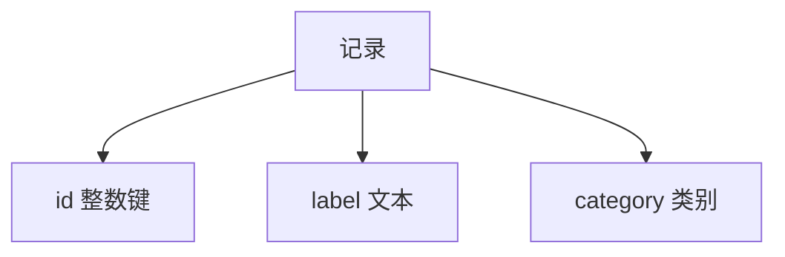
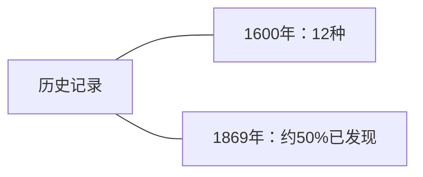
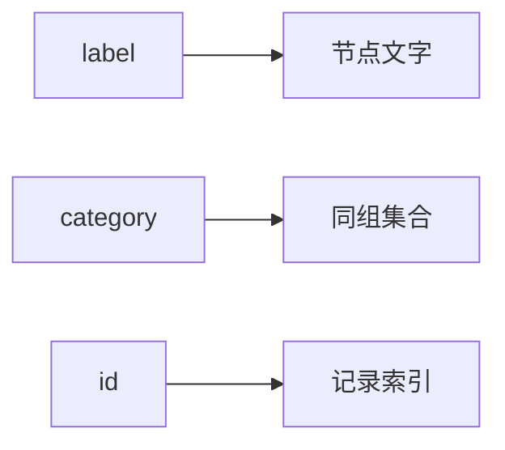
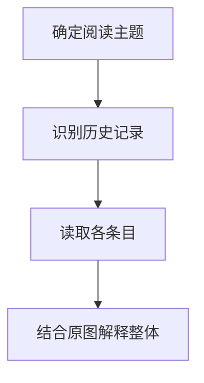

# 11-比较型：元素发现累计图

## 原图与来源

[作品发布页面](https://commons.wikimedia.org/wiki/File:Cumulative_diagram_of_element_discoveries.png)；作者：Happybara；授权：见原页。图像外链引用，未修改原图。

## 定义与选取依据
通过共同维度对照多个对象。本篇从该类型视角研究作品，部分案例为相邻类型参考而非严格典型。尤其字母表型需要另核对实际排序；手稿型研究拼贴中的历史手写材料，而非整个拼贴都属于手稿。

## 原始数据与清洗
依据作品发布说明抽取以下项目，非完整图内转录。

| 原始描述 | 规范标签 | 清洗规则 |
|---|---|---|
| 1600年：12种 | 1600年：12种 | 保留原义及近似标记，不补造数值 |
| 1869年：约50%已发现 | 1869年：约50%已发现 | 保留原义及近似标记，不补造数值 |

## 清洗后数据集
| id | label | category |
|---|---|---|
| 1 | 1600年：12种 | 历史记录 |
| 2 | 1869年：约50%已发现 | 历史记录 |

数据字典：id 为本地整数键；label 为来源描述的中文规范标签；category 为研究者标注的字段类别。缺失的原始量值不填零。

## 数据结构图

## 字段组合与统计方式
label 与 category 组成可分类检索的信息单元；id 与 label 提供唯一索引。本次抽取 2 条，不能代表原图全部数据。仅可统计抽样条目数，不可把类别计数误作实际对象数量或份额。

## 基础图形

上图用于展示来源说明中的条目集合，不声称各节点之间有直接因果或真实父子关系。1600年的12种与1869年的约50%单位不同，不应直接绘制同轴柱形比较。

## 视觉编码图

## 叙事结构

## 设计总结与限制
通过共同维度对照多个对象。本图为发布说明支持的抽样分析，不是全量复刻。原图图例、完整数值及实际视觉编码需进一步逐项核对。Mermaid 图为自主分析图。
