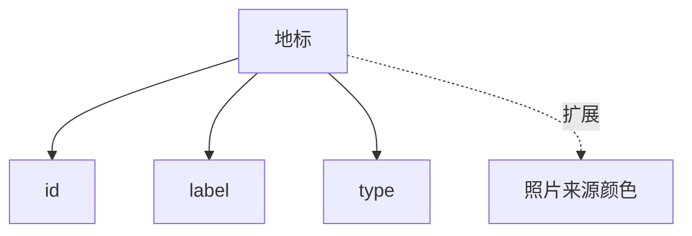
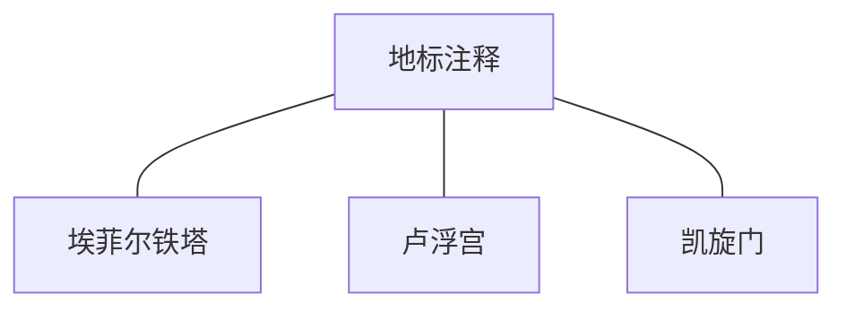
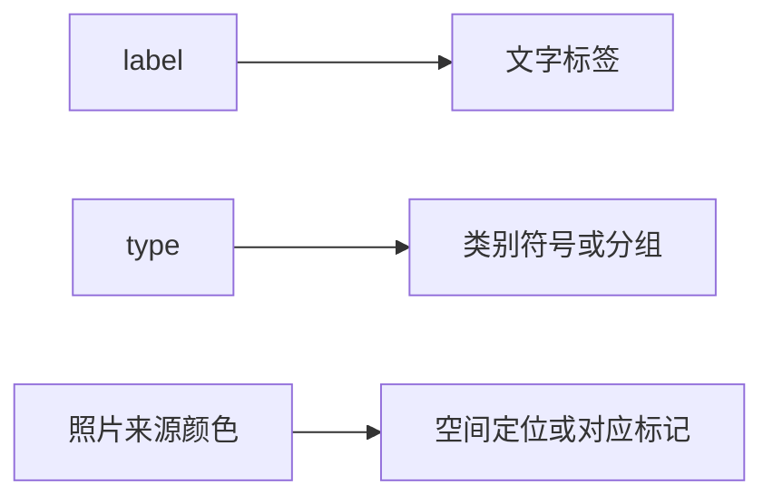

# 12-地标型 · 巴黎照片分布与地标注释

## 1. 原始案例图片

[原始发布页及授权](https://commons.wikimedia.org/wiki/File:Tourism_in_Paris.jpg)；作者：Eric Fischer；底图 OpenStreetMap；授权：CC BY-SA 2.0；底图 CC BY-SA。未修改原图。

## 2. 定义与特征

以可辨识地点或建筑作为视觉锚点，建立地点、名称与空间位置的关联。 作品页注释确认三个地标；蓝色代表本地人照片，红色代表游客照片，黄色代表身份不确定。没有照片数量，不按颜色面积估算。

## 3. 原始资料摘录与数据清洗

以下为发布说明支持的结构抽样及明确标记的研究者分析项，非完整原图转录。

| 原始描述或分析项 | 规范标签 | 类型 |
|---|---|---|
| Tour Eiffel | Tour Eiffel | 地标 |
| Le Louvre | Le Louvre | 地标 |
| Arc de Triomphe | Arc de Triomphe | 地标 |

清洗规则：去首尾空白，统一文本类型，保留标签语义；id 为新建本地键。缺失坐标、流量或数量保留为空，不补造。作品页注释确认三个地标；蓝色代表本地人照片，红色代表游客照片，黄色代表身份不确定。没有照片数量，不按颜色面积估算。

## 4. 清洗后数据集

| id | label | type |
|---:|---|---|
| 1 | Tour Eiffel | 地标 |
| 2 | Le Louvre | 地标 |
| 3 | Arc de Triomphe | 地标 |

数据字典：id（整数，本地唯一键）；label（文本，地标名称或分析项）；type（分类文本，研究者归类）。类别与照片来源颜色可作为后续扩展字段，未知量值不填零。

## 5. 数据结构

## 6. 字段组合与统计

label + type 用于区分对象；id + label 用于索引；扩展关系字段用于组织对象联系。此次抽样为 3 条，不能代表原作对象总数。定性数据无需强行使用均值或占比。

## 7. 基础图形与统计图形

作品页注释确认三个地标；蓝色代表本地人照片，红色代表游客照片，黄色代表身份不确定。没有照片数量，不按颜色面积估算。 此图为研究分析示意，不是等比例地图或数量流图。RAWGraphs 推荐：有真实经纬度时采用点地图或区域地图；地理位置不可用普通类别排序替代。

## 8. 视觉编码映射图

## 9. 叙事结构

## 10. 设计总结与限制

以可辨识地点或建筑作为视觉锚点，建立地点、名称与空间位置的关联。 原图链接已查到公开发布记录；当前为定性分析，未完成全图逐项校对及 GitHub 实际渲染验证。
