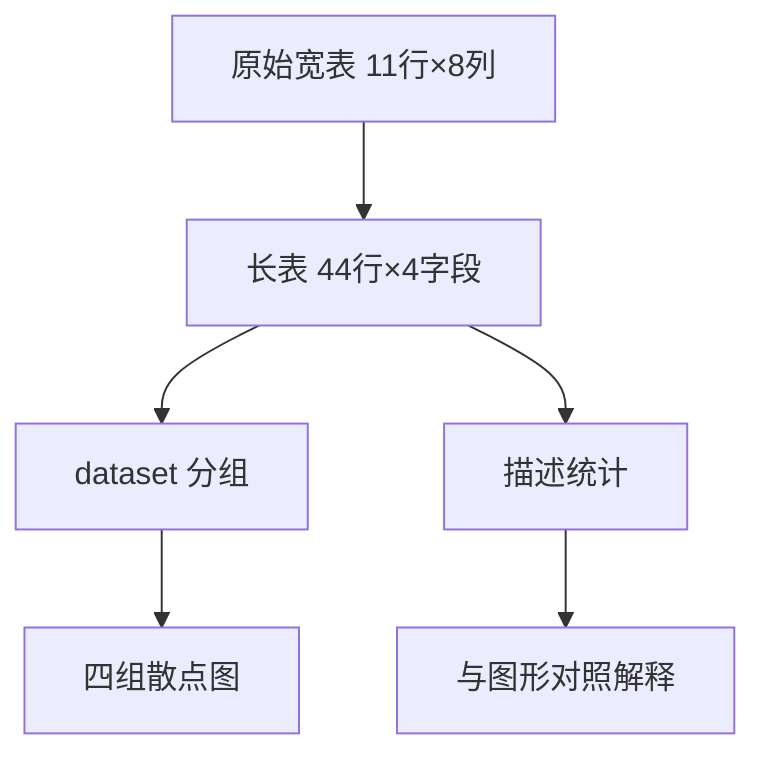

# 单一图表型案例A：Anscombe 四重奏——为什么必须先画图


- 原图：[Wikimedia Commons 文件页](https://commons.wikimedia.org/wiki/File:Anscombe%27s_quartet.svg)
- 原图作者：Schutz；图形由 R 绘制；衍生版本 Avenue；GPL 2.0 或更高版本。
- 数据原始研究：Francis J. Anscombe，1973，《Graphs in Statistical Analysis》。
- 数据核对：[R 官方 datasets 文档](https://stat.ethz.ch/R-manual/R-devel/library/datasets/html/anscombe.html)；[WHO 欧洲区数据可视化指南所列完整数据表](https://iris.who.int/bitstream/handle/10665/342568/WHO-EURO-2021-1998-41753-57181-eng.pdf?sequence=1)。

## 1. 类型定义与选取依据
单一图表型以一幅主图集中表达一个核心问题。本案例以四个散点子图组成一个图表组，核心问题是：传统汇总统计量相近的数据，是否具有相同分布形态？它是统计图表案例，不是把四幅图误当成四种独立类型。

## 2. 原始数据
来源数据共11个观测、8个字段，四组分别为 (x1,y1) 至 (x4,y4)。原始数据逐行转录如下。

|观测|x1|y1|x2|y2|x3|y3|x4|y4|
|---:|---:|---:|---:|---:|---:|---:|---:|---:|
|1|10|8.04|10|9.14|10|7.46|8|6.58|
|2|8|6.95|8|8.14|8|6.77|8|5.76|
|3|13|7.58|13|8.74|13|12.74|8|7.71|
|4|9|8.81|9|8.77|9|7.11|8|8.84|
|5|11|8.33|11|9.26|11|7.81|8|8.47|
|6|14|9.96|14|8.1|14|8.84|8|7.04|
|7|6|7.24|6|6.13|6|6.08|8|5.25|
|8|4|4.26|4|3.1|4|5.39|19|12.5|
|9|12|10.84|12|9.13|12|8.15|8|5.56|
|10|7|4.82|7|7.26|7|6.42|8|7.91|
|11|5|5.68|5|4.74|5|5.73|8|6.89|

## 3. 数据清洗与转换
本数据集已是数值型、无缺失的标准教学数据。清洗不应伪造删除或填补步骤。

|检查项|检查结果|处理|
|---|---|---|
|行数|11|保留全部11个观测|
|字段|8个数值字段|拆分为四组 x/y 配对|
|缺失值|无|无需填补|
|重复记录|无完全重复行|保留|
|离群/高影响点|第三组观测3；第四组观测8|不删除，标记并解释|
|小数精度|y值保留两位小数|原样保留|

长表转换后每个观测一行，共44行，字段为 dataset、observation、x、y。dataset 为 I–IV 分类；observation 为 1–11 整数；x、y 为数值型。原始宽表保留以便追溯。

## 4. 清洗后数据集（长表）
|组别|观测|x|y|
|---|---:|---:|---:|
|I|1|10|8.04|
|II|1|10|9.14|
|III|1|10|7.46|
|IV|1|8|6.58|
|I|2|8|6.95|
|II|2|8|8.14|
|III|2|8|6.77|
|IV|2|8|5.76|
|I|3|13|7.58|
|II|3|13|8.74|
|III|3|13|12.74|
|IV|3|8|7.71|
|I|4|9|8.81|
|II|4|9|8.77|
|III|4|9|7.11|
|IV|4|8|8.84|
|I|5|11|8.33|
|II|5|11|9.26|
|III|5|11|7.81|
|IV|5|8|8.47|
|I|6|14|9.96|
|II|6|14|8.1|
|III|6|14|8.84|
|IV|6|8|7.04|
|I|7|6|7.24|
|II|7|6|6.13|
|III|7|6|6.08|
|IV|7|8|5.25|
|I|8|4|4.26|
|II|8|4|3.1|
|III|8|4|5.39|
|IV|8|19|12.5|
|I|9|12|10.84|
|II|9|12|9.13|
|III|9|12|8.15|
|IV|9|8|5.56|
|I|10|7|4.82|
|II|10|7|7.26|
|III|10|7|6.42|
|IV|10|8|7.91|
|I|11|5|5.68|
|II|11|5|4.74|
|III|11|5|5.73|
|IV|11|8|6.89|

## 5. 数据字典与字段组合
- dataset：类别型，四组实验数据的标识。
- observation：整数型，组内观测编号。
- x：数值型，自变量。
- y：数值型，因变量。
- dataset + observation：复合主键。
- x + y：构成散点图中的一个点。
- dataset + x + y：用于分面比较四组分布。
- x + y + 回归模型：用于检查趋势与高影响观测。

## 6. 描述统计与统计含义
四组的均值、方差、相关系数及回归线几乎相同（均值 x=9，y=7.5；相关系数约0.816；回归线约 y=3+0.5x），但分布形态显著不同。均值、相关系数不能替代分布检查。

## 7. 实际统计图形：四组散点图
```mermaid
xychart-beta
 title "Anscombe 四重奏：数据集 I"
 x-axis [4,5,6,7,8,9,10,11,12,13,14]
 y-axis "y" 0 --> 14
 scatter [4.26,5.68,7.24,4.82,6.95,8.81,8.04,8.33,10.84,7.58,9.96]
```

```mermaid
xychart-beta
 title "Anscombe 四重奏：数据集 II"
 x-axis [4,5,6,7,8,9,10,11,12,13,14]
 y-axis "y" 0 --> 14
 scatter [3.1,4.74,6.13,7.26,8.14,8.77,9.14,9.26,9.13,8.74,8.1]
```

```mermaid
xychart-beta
 title "Anscombe 四重奏：数据集 III"
 x-axis [4,5,6,7,8,9,10,11,12,13,14]
 y-axis "y" 0 --> 14
 scatter [5.39,5.73,6.08,6.42,6.77,7.11,7.46,7.81,8.15,12.74,8.84]
```

```mermaid
xychart-beta
 title "Anscombe 四重奏：数据集 IV"
 x-axis [8,8,8,8,8,8,8,8,8,8,19]
 y-axis "y" 0 --> 14
 scatter [6.58,5.76,7.71,8.84,8.47,7.04,5.25,12.5,5.56,7.91,6.89]
```

说明：上面 Mermaid 散点语法的支持情况依赖 GitHub Mermaid 版本；若不支持 scatter，应以原始 SVG 原图和下方统计图表作为可靠呈现。更推荐在 RAWGraphs 中选择 Scatter Plot，将 x、y 映射到横纵轴，dataset 映射为颜色或分面，observation 映射为标签。

## 8. 视觉编码分析
|数据字段|视觉变量|作用|
|---|---|---|
|x|水平位置|自变量大小|
|y|垂直位置|因变量大小|
|dataset|颜色/分面|区分四组|
|observation|点标签（可选）|定位具体观测|
|回归预测值|参考线|显示线性模型趋势|

四图使用一致坐标范围，避免尺度变化掩盖差异。点的位置承载两个连续变量，颜色只用于区分组别，不应再用面积或颜色深浅暗示未提供的第三变量。

## 9. 数据结构图


## 10. 叙事结构


## 11. 设计规律与限制
单一图表应让主视觉直接回答核心问题；小多图必须共享坐标尺度；图形应先于模型解释，异常点不应为美观而删除。该案例数据和原图来源可追溯；图形绘制采用 Mermaid 示范，GitHub 实际渲染尚待页面检查。
