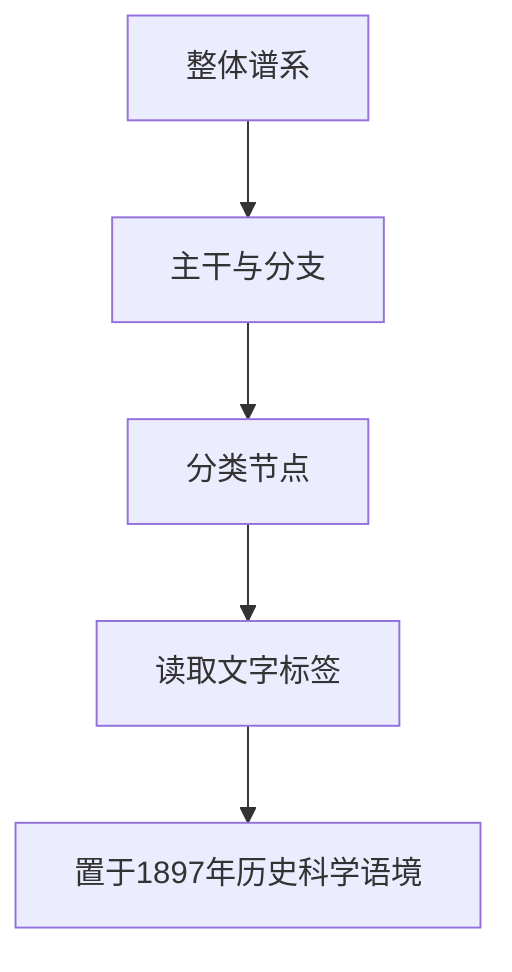

# CASE-0002｜Ernst Haeckel《Pedigree of Man》（人类谱系图）

- **作者：** Ernst Haeckel
- **作品年代：** 1897（《The Evolution of Man》英文版图版）
- **原图与版权：** [Wikimedia Commons 原图档案](https://commons.wikimedia.org/wiki/File:Pedigree_of_Man_English.jpg)，标注为公有领域。
- **选取依据：** 文字标签、字体样式和树状图形共同构成分类叙事。

## 基础类型主归属

**层级型**为基础逻辑主归属：作品以分支和上下位关系表达谱系。文字可视化是表现标签，因为文字内容及其排版参与信息分组和识别；不能仅因它含有大量文字就将其判为编目型。

## A｜基本数据逻辑

最小记录单元为谱系中的一个分类／生物群节点。关系结构为节点—分支—上位群组，属于树状层级关系。原图是历史科学图示，其分类和演化观念属于特定历史语境，不能直接当作现代生物学共识。

## B｜统计图形与计算

不使用数量统计。主要借用树状图／谱系图的节点连接和分支结构；没有可核验的数值字段，不进行频数、比例或显著性计算。

## C｜视觉编码

- **文字：** 名称和标签承载节点身份。
- **线：** 分支线表示谱系连接；线的连接关系比装饰样式更重要。
- **字体：** 字体家族、字重、大小写等可作为分类提示，但需回到原图图例和原始出版说明核验具体映射。
- **面与色彩：** 主要服务于结构区分和版面层级，不应擅自解释为数量。
- **阅读风险：** 19世纪演化图常包含现已过时的理论框架，必须将“历史作品分析”与“现代科学事实”区分。

## D｜数据／信息架构

目前只建立作品级数据记录，不虚构完整物种节点表：

| record_id | field | value | evidence |
|---|---|---|---|
| 1 | title | Pedigree of Man | Commons 元数据 |
| 2 | creator | Ernst Haeckel | Commons 元数据 |
| 3 | publication_year | 1897 | Commons 元数据 |
| 4 | source_work | The Evolution of Man | Commons 元数据 |
| 5 | diagram_structure | branching pedigree | 原图可见 |

一行一个作品级字段记录。若后续要转录节点，应逐项从高分辨率原图读取，并另建 `node_id`、`parent_id`、`label`、`branch_type` 表；本次不根据缩略图猜测节点名称。

## E｜视觉叙事架构

读者先看到整体树状结构，再沿主干和分支追踪关系，最后读取节点名称。叙事由“整体谱系—分支结构—具体标签”构成。树形结构提供阅读路径，但并不自动证明所有分支具有现代科学意义上的确定祖先关系。

## 数据清洗记录

- 将作者、年份、作品名和来源书目整理为规范字段。
- 年份统一为四位整数 1897。
- 将“Pedigree of Man”作为作品标题保留原文。
- 不从低清缩略图批量臆造节点清单。
- 将图形关系标注为“图面结构观察”，不等同于重新验证其科学结论。

## 清洗后数据集

见同目录 `数据集.csv`。数据集是作品级元数据与图面结构描述，不是物种计数数据。

## 统计图形与视觉编码结论

该作品借用树状谱系图，而不是统计图。它的主要视觉变量是节点位置、分支连接、文字标签与字体层级。文字可视化标签在此处表现为“文字与结构协同”，而不是词频大小。

## 叙事结构

## 基础设计规律

当文字作为层级图的节点内容时，文字样式可以强化类别识别，但必须与连接结构共同阅读。历史图示需要注明年代与知识语境，避免把历史分类直接当作当代事实。

## 证据与限制

作品作者、年代和来源由 Commons 档案支持；节点级数据未完整转录。原图为历史科学材料，本文分析其视觉结构，不为其全部科学主张背书。
