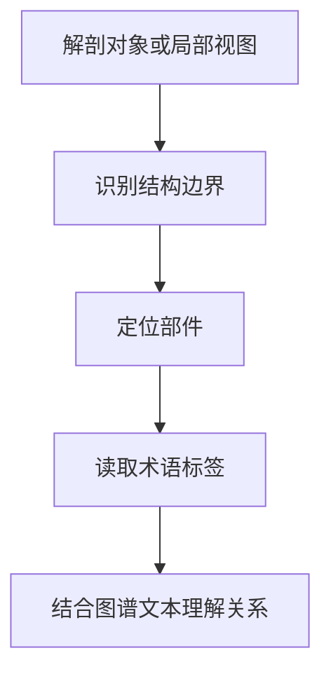

# CASE-0001｜Sobotta《人体解剖学图谱》（1909版图版246）

- **作者：** Johannes Sobotta
- **作品来源：** *Sobotta's Atlas and Text-book of Human Anatomy*，1909年美国版
- **原图与版权：** [Wikimedia Commons 档案](https://commons.wikimedia.org/wiki/File:Sobo_1909_246.png)，标注 Public Domain Mark。
- **选取依据：** 真实历史解剖学图谱图版，采用精细绘制和标注来说明人体结构。

## 基础类型主归属

**层级型**（结构层级）作为基础逻辑主归属：解剖图以整体—器官—局部结构的包含和定位关系组织信息。解剖型是表现标签。

## A｜基本数据逻辑

本图不是传统数值数据图。最小信息单元为一个被描绘或标注的解剖结构；其关系可能包括组成、邻接、位置和局部放大。当前 Commons 元数据仅确认该文件为 Sobotta 图谱中的解剖插图，没有在文字说明中列出本图所有结构名称，因此不凭文件编号猜测具体器官。

## B｜统计图形与计算

没有可核验统计变量或数值轴，不适用均值、比例、频数等统计计算。借用的是解剖图、定位标注和局部结构示意，不将器官数量统计伪装成作品原本的数据。

## C｜视觉编码

- **线：** 轮廓线描绘结构边界；若存在引线，其作用是连接标签与结构。
- **面／色彩：** 不同组织的色调和明暗用于区分结构、层次或深浅。
- **体：** 透视、遮挡和局部剖示帮助解释空间关系。
- **文字：** 术语标签承担精确命名；字体层级用于区分标题、部件名和说明。
- **风险：** 历史图谱术语、比例和绘图规范可能与现代标准存在差异，不能作为临床诊断依据。

## D｜数据／信息架构

当前可可靠建立的是作品元数据：

| record_id | field | value |
|---|---|---|
| 1 | atlas | Sobotta's Atlas and Text-book of Human Anatomy |
| 2 | creator | Johannes Sobotta |
| 3 | edition_year | 1909 |
| 4 | plate_file | Sobo 1909 246.png |
| 5 | content_type | anatomical illustration |

一行一个作品元数据字段。由于当前档案简介没有列出本图完整标注词条，器官／组织字段留待对照原图逐项转录，不填猜测值。

## E｜视觉叙事架构

典型解剖图阅读方式为：先识别整体或局部视图，再定位目标结构，沿轮廓、剖面和引线读取部件名称，最后结合图谱正文理解结构关系。具体阅读路径应以原图实际布局为准。

## 数据清洗记录

1. 作者统一为 Johannes Sobotta。
2. 年份统一为 1909。
3. 原文件名保留，避免图版编号错配。
4. 不从文件名推断具体解剖部位。
5. 未经逐项核验的标签不写入清洗数据。

## 清洗后数据集

见同目录 `数据集.csv`。它是作品元数据集，不是器官数量或临床测量数据。

## 统计图形与视觉编码结论

本例主要借用解剖插画与标注系统，而非统计图。视觉准确性依赖结构轮廓、空间层次、引线指向与术语对应。

## 叙事结构

## 基础设计规律

解剖型信息图的核心不是“画得像”，而是结构关系可辨、标签指向明确、术语准确。图像细节必须服务于解释目标；没有来源支持的器官名称不可补写。
