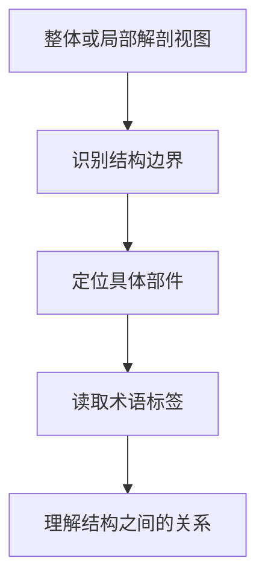

# CASE-0002｜Sobotta《人体解剖学图谱》（1911版图版807）

- **作者：** Johannes Sobotta
- **作品来源：** *Sobotta's Atlas and Text-book of Human Anatomy*，1911年版
- **原图与版权：** [Wikimedia Commons 档案](https://commons.wikimedia.org/wiki/File:Sobo_1911_807.png)，标注 Public Domain Mark。
- **选取依据：** 真实历史解剖学图谱图版，以解剖插画和标注组织人体结构知识。

## 基础类型主归属

**层级型**（结构包含关系）为基础逻辑主归属；解剖型是表现标签。图面以身体结构及其局部组成关系为阅读对象。

## A｜基本数据逻辑

最小信息单元为一个被描绘或标注的解剖结构；结构之间可能具有组成、邻接、位置和局部放大关系。Commons 档案确认该文件来自 Sobotta 1911 年版解剖图谱，但没有在元数据摘要中列出本图全部结构标签。因此本案例不根据文件编号推断具体器官或部位。

## B｜统计图形与计算

本图不属于数值统计图，不存在可核验的数值轴或统计量。其图形方法是解剖插画、结构轮廓、空间定位与标注。不得从图中器官数量推导人体统计结论。

## C｜视觉编码

- **线：** 轮廓线描绘结构边界；引线（如图面存在）连接结构与文字标签。
- **面与色彩：** 不同组织的色调、明暗或纹理用于区分结构层次。
- **体：** 透视、遮挡或局部剖示帮助解释空间关系。
- **文字：** 术语标签承担精确命名，字号和位置服务于识别。
- **风险：** 历史图谱术语、比例与绘图规范可能与现代标准存在差异，不能作为临床诊断依据。

## D｜数据／信息架构

目前可可靠建立作品级元数据，而不是未核实的器官清单：

| record_id | field | value |
|---|---|---|
| 1 | atlas | Sobotta's Atlas and Text-book of Human Anatomy |
| 2 | creator | Johannes Sobotta |
| 3 | edition_year | 1911 |
| 4 | plate_file | Sobo 1911 807.png |
| 5 | content_type | anatomical illustration |

一行一个作品元数据字段。若后续需要器官级数据，必须逐项读取高分辨率原图并记录原始标签。

## E｜视觉叙事架构

解剖图通常先呈现整体或局部视图，再通过轮廓、剖面、空间位置和标注定位具体结构，最后将局部结构放回整体身体系统理解。具体阅读顺序仍应以原图实际布局为准。

## 数据清洗记录

1. 作者规范为 Johannes Sobotta。
2. 版本年份规范为 1911。
3. 保留原始文件名，避免图版错配。
4. 不从文件编号推断解剖部位。
5. 元数据中没有列出的标签不补写。

## 清洗后数据集

见同目录 `数据集.csv`。该表是作品元数据集，不是器官数量或临床测量数据。

## 统计图形与视觉编码结论

本例借用解剖插画和标注系统，而非统计图。视觉准确性依赖结构轮廓、空间层次、标签指向和术语对应。

## 叙事结构

## 基础设计规律

解剖型信息图的核心不是“画得像”，而是结构关系可辨、标签指向明确、术语准确。没有来源支持的器官名称不可补写。

## 证据与限制

作者、版本年代和公有领域状态来自 Commons 档案；当前未逐项转录图版上的所有结构名称。
