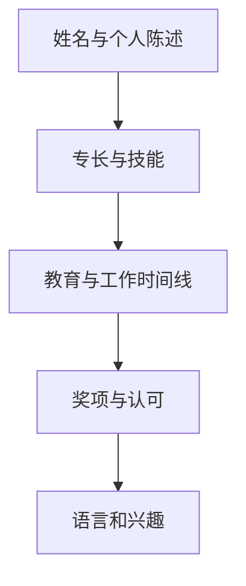

# CASE-0001｜Fernando Báez 信息图简历模板

- **设计师：** Fernando Báez（Just Creative Ideas）
- **作品时间：** 约2012年前后设计；2018年 PRINT Magazine 访谈称设计于采访前六年完成。
- **来源：** Ellen Shapiro, PRINT Magazine, 2018-01-18
- **原图与背景：** [The Resume Template that Went Viral](https://www.printmag.com/branding-identity-design/the-resume-template-that-went-viral/)
- **图像版权：** 作品归设计师／原发布者；本仓库采用来源页图片外链，未重新托管。

## 基础类型主归属

**编年型**为基础逻辑主归属：教育经历和工作经历沿时间顺序组织。视觉简历是内容用途标签，图标、技能点阵和环形语言图表是表现方式。

## A｜基本数据逻辑

最小记录单元包括一段教育经历、一段工作经历、一项技能、一种语言或一项奖励。核心结构是人物档案下的多组记录，其中教育与工作经历具有时间顺序，技能和兴趣属于分类条目。

## B｜统计图形与计算

图面包含技能点阵、语言能力环、工作年数大数字和图标化兴趣。它们主要是视觉编码，不一定是统计图。若点阵代表技能等级，需有等级刻度；原图没有完整可读的数值说明，因此不反推点数为精确能力分数。工作经历数字可作为时间跨度提示，但不能仅凭版面计算出精确总工龄。

## C｜视觉编码

- **点阵：** 技能熟练程度的等级／强度暗示；无图例时仅作定性读取。
- **环形图：** 语言熟练度以环形进度表现，但数值标尺未在图中清晰说明。
- **大数字：** 工作经历时段的视觉锚点。
- **图标：** 专业领域、兴趣爱好和奖励的快速识别符号。
- **线与分区：** 将教育、工作、技能、语言和兴趣组织成模块。
- **色彩：** 以黑白灰为主，形成克制、统一的视觉层级。

## D｜数据／信息架构

从图面可确认的字段包括：个人陈述、专长、设计技能、语言技能、教育、工作经验、认可／奖项、兴趣爱好。工作经验区出现年份跨度；教育区按时间列出经历。以下 CSV 是字段结构示意，记录内容只录入来源图面可读且可靠的信息，不猜测小字细节。

## E｜视觉叙事架构

先通过姓名和个人陈述建立身份，再通过专长与技能形成能力印象；接着以教育和工作经历证明履历，最后以奖项、语言和兴趣补足个人画像。阅读路径是“身份—能力—经历—补充特征”。

## 数据清洗记录

1. 将简历信息拆分为模块字段，避免将一整块文本作为单一记录。
2. 日期统一为年份或年份区间；图面无法确认的具体月份不补写。
3. 技能和语言等级若无明确刻度，保留为图面视觉等级，不转成百分比。
4. 个人联系方式等敏感字段不抄入研究数据集。
5. 仅保留作品结构和可核验的专业模块，不复制个人隐私信息。

## 清洗后数据集

见同目录 `数据集.csv`。数据为作品结构层级与模块清单，不是对个人能力的客观测量。

## 统计图形与视觉编码结论

视觉简历把时间轴、分类清单、图标和小型定量图形组合成个人信息仪表板。它的主要价值在于压缩和组织信息；若缺少量表，技能点阵和环图只能作视觉等级提示，不能被当作可比较的真实测量值。

## 叙事结构

## 基础设计规律

视觉简历必须把“快速扫描”和“准确核验”同时考虑：模块标题负责导航，时间轴负责经历顺序，图标负责压缩语义；涉及技能等级时必须提供明确量表，否则避免伪精确。

## 证据与限制

设计师与作品背景来自 PRINT Magazine 访谈；图面细小文本部分无法全部可靠读取，因此不做完整个人经历转录。
