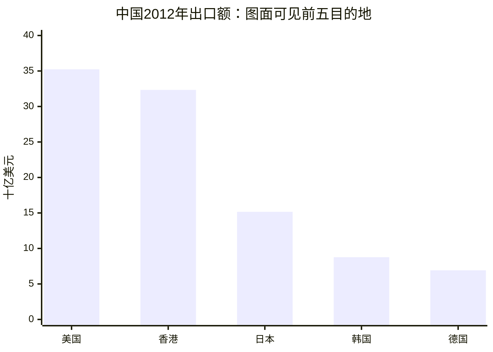

# CASE-0002｜China’s 2012 Export Flows（三维地球出口流向图）

- **作者：** Michel Alimasi（Flourish 公开作品）
- **主题：** 中国2012年出口贸易流向
- **原图：** [Flourish 可视化页面](https://public.flourish.studio/visualisation/14895072/)
- **图面可读数据：** 中国出口额排名前五的目的地及金额，单位为十亿美元（B）。
- **图像性质：** 真实发布的交互式数据可视化缩略图；可视化页面支持年份及进出口切换。

## 基础类型主归属

**地理图型**为基础逻辑主归属：数据按出口来源国与目的地国家的空间流向组织。三维型为表现标签。

## A｜基本数据逻辑

最小记录单元为一条贸易流（出口国—目的国—年份—金额）。数据具有有向关系：China → destination。图面以球体承载地理位置，以弧线表现跨国流动。

## B｜统计图形与计算

采用三维地球流向图（3D flow map）。图面列出2012年中国出口前五目的地金额：美国35.24、香港32.34、日本15.16、韩国8.77、德国6.92（十亿美元）。五项合计为98.43十亿美元。该合计仅是图面展示的前五项之和，不是中国全年出口总额。

## C｜视觉编码

- **球体位置：** 国家地理位置。
- **弧线方向：** 出口流向，由中国指向目的地。
- **弧线／带状元素：** 表示贸易流；截图中不应凭线宽推断精确金额，具体量值以旁侧列表为准。
- **颜色：** 以暖色流线对比蓝色地球，突出贸易路径；是否还编码商品类别需依据完整交互视图确认。
- **文字列表：** 直接显示目的地排名和金额，提供精确读取。
- **时间控件：** 允许切换年份，支持时间比较。

## D｜数据／信息架构

清洗后数据以一行一条国家贸易流组织，字段为 `year`、`exporter`、`importer`、`export_value_usd_billion`、`rank_in_visible_top5`。本次转录仅覆盖图面明确显示的前五目的地，不代表完整 UN Comtrade 数据集。

## E｜视觉叙事架构

读者先看到地球整体和中国出口主题，再通过流线感知贸易联系，随后读取左侧目的地排行榜和金额，最后可通过年份控件探索时间变化。空间关系负责“流向”，列表负责“精确数值”。

## 数据清洗记录

1. 年份统一为整数2012。
2. 金额统一为十亿美元，保留图面小数位两位。
3. 国家名称统一为图面英文名称；Hong Kong 单独作为目的地记录，不擅自改写为其他政治实体口径。
4. 只转录可见的 Top 5；不补造其余国家金额。
5. 金额合计只计算可见五条记录：35.24+32.34+15.16+8.77+6.92=98.43。

## 清洗后数据集

见同目录 `数据集.csv`。它是从可视化图面转录的 Top 5 子集，非完整海关贸易数据。

## 统计图形与视觉编码结论

三维地球流向图适合展示国际联系的方向和地理分布；侧边列表补足金额精度。球面投影与弧线重叠可能降低局部可读性，交互式筛选能缓解遮挡。

## 叙事结构

## 基础设计规律

三维地球适合表达全球连接，但应提供列表或表格显示准确数值。空间位置与流向应分开编码；金额单位和年份必须清晰，不能让视觉效果替代数据口径。

## 证据与限制

金额来自图面明确显示的前五目的地列表；未取得底层完整贸易数据，因此只分析和清洗可见子集。

## 辅助统计图形：可见 Top 5 出口额条形图

将球面流向图中明确标注的五个出口额转换为二维条形图，便于精确比较：

五项合计98.43十亿美元，仅代表图面显示的前五目的地，不代表中国全年出口总额。
