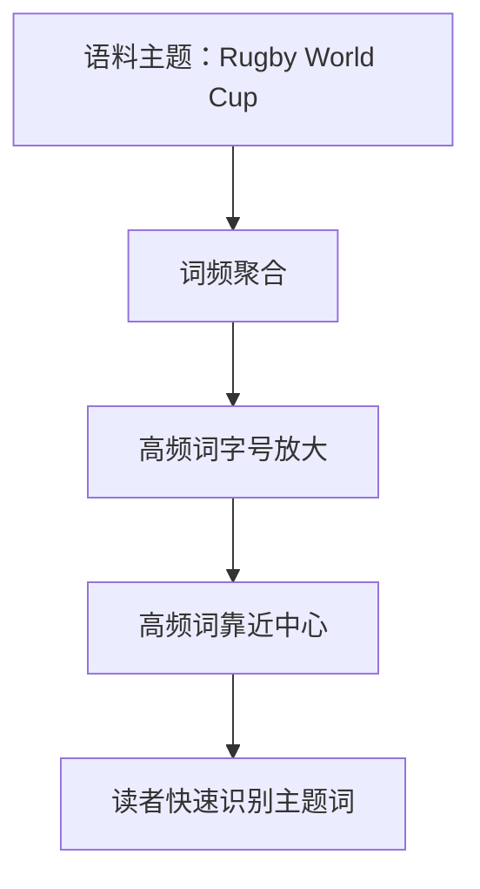

# CASE-0001｜Rugby World Cup Wikipedia Word Cloud（橄榄球世界杯词云）

- **作品来源：** *How Data Visualisation Works*，第13章 Text，Figure 13.10
- **语料来源：** 2024年引用的 Wikipedia Rugby World Cup 页面
- **原图与说明：** [第13章 Text—Word Clouds](https://pmur002.github.io/hdvw/text.html)
- **原始数据说明：** 来源明确给出 287 个不同词项，图中展示词频相对大小；正文表13.1列出出现次数最高的六个词。

## 基础类型主归属

**编目型**为基础逻辑主归属：词项作为条目集合，以词频聚合并排序。词云是表现形式，不代表词与词之间存在父子关系。

## A｜基本数据逻辑

最小记录单元为一个词项及其在语料中的出现次数。清洗流程应从页面文本开始，经过分词、大小写规范、标点处理、停用词处理，再聚合为一行一个词项。来源只提供聚合结果中的前六项和总词项数，未提供全量287词表，因此本次仅转录可核验六项。

## B｜统计图形与计算

使用词频计数（term frequency）。图面将词频映射到文字大小，并把较高频词放在更靠近中心的位置。来源明确指出字号不适合精确读取数值，长词会因字形宽度占用更大面积；词云适合粗略的序位比较，不适合精确数量比较。

## C｜视觉编码

- **文字模式：** 词本身代表词项身份。
- **字号：** 表示相对词频。
- **位置：** 高频词更靠近中心，形成冗余编码。
- **角度：** 词语方向变化没有数据意义，属于不一致编码，可能误导读者。
- **色彩：** 作为装饰或辅助分组，来源未说明其承载定量值。
- **建议：** 配合条形图或词频表展示精确数值。

## D｜数据／信息架构

清洗后数据一行一个词项，字段为 `word`、`frequency`、`rank`、`source_scope`。本次只包含来源表13.1明确展示的六项，不扩写成全量词表。

## E｜视觉叙事架构

先以“Rugby World Cup”主题确定语境，再通过最大词项 rugby、world、tournament、cup 建立主题识别，最后通过国家名 New Zealand 等次级词项提示赛事相关实体。中心位置和字号共同引导视线。

## 数据清洗记录

1. 只保留来源明确列出的六个词频。
2. 词项统一小写，保留原词语义。
3. frequency 转为整数。
4. 按频数从高到低排序；相同频数时保留来源次序。
5. 不把来源没有展示的其余281个词补成猜测值。

## 清洗后数据集

见同目录 `数据集.csv`。六条记录来自来源表13.1，来源指出全体有287个不同词项；这份 CSV 是公开样本而非全量数据。

## 统计图形与视觉编码结论

词云以文字形状作为数据符号、字号与空间位置表达相对频率。与条形图相比，它更能保留词项语义和整体主题，但数值解码精度较低。

## 叙事结构

## 基础设计规律

词云的字号只适合展示相对重要程度；精确比较应配套词频表或条形图。词语旋转角度如果不映射数据，就应尽量减少，避免产生虚假的语义暗示。

## 证据与限制

六项词频及287个不同词项的描述来自书籍章节；没有取得原始 Wikipedia 页面抓取快照和完整词表，无法重建全量清洗过程。
