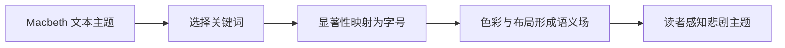

# CASE-0002｜Shakespeare’s Macbeth Wordle（麦克白词云）

- **作品对象：** William Shakespeare, *Macbeth*
- **参考记录：** Ruben Puentedura 的 Wordle 截图案例，见 *Rethinking Data Visualization: From Dynamic Illustration to Analytic Narrative* 中的 Literary Analytic Story；当前配图为 WordCloud.app 公开的 Macbeth 词云示例，用于对照同一文本题材的词云表现。
- **原图链接：** [WordCloud.app Macbeth](https://wordcloud.app/books/macbeth-by-william-shakespeare)
- **方法参考：** [Rethinking Data Visualization PDF](https://hippasus.com/resources/swarthmore2010/1_RethinkingVisualization.pdf)
- **版权：** 配图由 WordCloud.app 页面发布；引用原图链接，不声称拥有图片版权。

## 基础类型主归属

**编目型**为基础逻辑主归属：词语作为条目集合，按主题显著性／频率权重进行视觉排布。词云是表现形式。

## A｜基本数据逻辑

最小记录单元是一个词或短语。理想数据结构为 `term`、`frequency` 或 `weight`、`source_text`、`normalization_rule`。当前公开配图展示的是 Macbeth 的主题词汇，WordCloud.app 页面描述为48个关键主题词；参考 PDF 中另有 Wordle 的 Macbeth 词云，说明其取自剧本文本 top 100 词，并去除舞台说明和规范拼写。两者属于同一题材的不同词云生成版本，不能混作同一数据集。

## B｜统计图形与计算

本次案例以 WordCloud.app 公开配图作真实图像案例，页面没有公开每个词的频数和算法权重，因此不能声称字号严格对应原始词频。PDF 中的 Wordle 参考图则明确使用 top 100 words，去除舞台说明并规范拼写，但未给出完整数值表。故本案例统计计算状态为**部分可知**，不反推具体频数。

## C｜视觉编码

- **文字：** 词项本身承载主题语义。
- **字号：** 表示页面生成器设定的显著性或权重；没有公开量表时只作序位理解。
- **色彩：** 紫色系形成统一主题氛围，页面未说明色彩对应数据类别。
- **方向：** 横排与竖排混用，主要服务于空间填充，不应解释为额外变量。
- **位置：** 中心与边缘共同构成密集词群；无明确语义分组图例时不推断词间关系。

## D｜数据／信息架构

可从公开页面确认作品包含48个关键主题词；但页面未公开完整词表和权重。因此清洗后 CSV 仅记录可见且明确可辨的主题词样本，权重留空并标注未公开。不得把图面词语按视觉大小估算成频数。

## E｜视觉叙事架构

通过高显著性主题词（如 AMBITION、darkness、BETRAYAL、madness）先建立《麦克白》的冲突与悲剧氛围，再由 guilt、deception、corruption 等次级词汇扩展主题。读者以整体语义场而非线性情节顺序阅读。

## 数据清洗记录

1. 只转录图面可清楚辨认的词项。
2. 统一为小写或保留词面大小写需在词云生成前确定；本 CSV 保留标准小写以便检索。
3. 不对词项进行词干化或同义词合并，因为没有原始语料和清洗脚本。
4. frequency／weight 留空，表示来源未公开，不代表0。
5. 不把 Wordle top 100 的描述与 WordCloud.app 的48个主题词合并。

## 清洗后数据集

见同目录 `数据集.csv`。该文件是词项可见样本与权重缺失标记，不是完整语料词频表。

## 统计图形与视觉编码结论

词云能把文本语义变成可快速浏览的视觉场，但若没有公开权重和词频表，不能支持精确比较。若研究重点是文本主题，可配合关键词分类；若研究重点是频数，则必须提供完整语料、分词规则和频数表。

## 叙事结构

## 基础设计规律

词云需要公开其词项筛选和权重口径。只展示主题词而没有可复算的词频时，应标为“主题词云／定性词云”，不能称为精确词频统计图。

## 证据与限制

WordCloud.app 页面支持48个关键主题词的说明；参考 PDF 支持 Wordle Macbeth top 100、去除舞台说明和拼写规范化的描述。当前没有取得该 WordCloud.app 作品的原始文本、词表或权重，因此 CSV 只保留图面样本与缺失状态。
